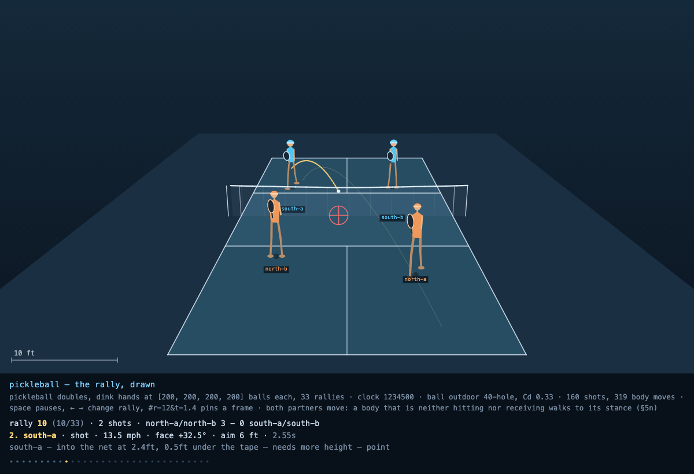
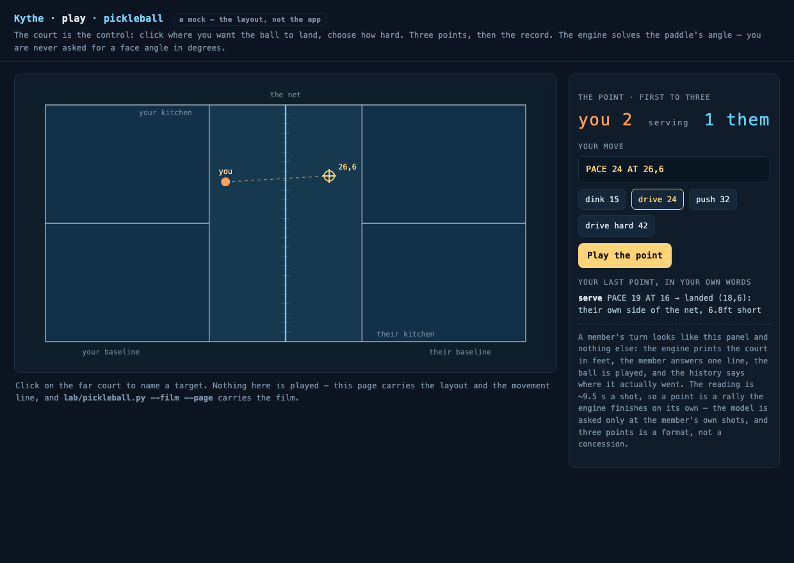

# pickleball — the ball is measured, the kitchen is the game

**Status: design page. No engine, no renderer, no code under `games/pickleball/`.** This file is the gate
the founder asked for on 2026-11-15: the ball's drag curve with its source, the kitchen and double-bounce
rules as the engine will enforce them, the doubles assignment rule, and the import list from
`lab/tennis.py` with **zero copied modules**. §4 ends with the number that closes the gate. §1 ends with a
finding that changes the order of work, and it is not the answer I expected when I started measuring.

*The name.* This is the `PaddleBall` of `games/tennis/BACKLOG.md` item 9, and it is **not** the game item 9
described. Item 9 accepted a project in which a **wall** replaces the net and the wall's imperfection is what
makes it a game — its stated risk being that a perfect wall is a machine, not an opponent. The founder's
instruction of 2026-11-15 names **pickleball** and asks for the **kitchen**, the **double bounce** and the
**doubles assignment**. Those three only exist in a game with a net and a real opponent across it, so the
wall is dropped and the sport is built. That is my decision to make, and it is the better one: the wall's
design risk was "a deterministic rebound teaches nothing beyond position"; the kitchen's risk is that its
best shot is *hard to measure*, and a measurement problem is solvable. What survives from item 9 untouched:
one physics implementation, imported from `lab/tennis.py`, never copied.

---

## §1 The ball: the drag curve, and where it comes from

The model is the one tennis already uses — `a = k · |v_rel| · v_rel`, quadratic in speed, relative to the
air — because the curve for a pickleball is the same parabola and only the constant differs. That the curve
needs no table is a measured claim: **two independent studies find the drag coefficient of a pickleball flat
across the whole velocity range the game uses, so there is no drag-crisis kink and nothing to interpolate.**
The curve is one number.

| quantity | value | source |
|---|---|---|
| `Cd`, 40-hole outdoor ball | **0.33** (86 trajectories, SD 0.083, SE 0.014) | Pickleball University / Tennis Warehouse University, *The Physics of Pickleball Aerodynamics and Trajectories*, May 2025 |
| `Cd`, 26-hole indoor ball | **0.45** (86 trajectories, SD 0.092, SE 0.013) | same |
| why there is no Cd(v) | no systematic dependence on Reynolds number **or** spin; flow already supercritical, no drag crisis | same; and Steyn et al. 2025 |
| `Cd`, 40-hole outdoor, second group | **0.30 ± 0.02** (6 digitised trajectories, Re 4.7–6.1 × 10⁴, spin parameter 0.03–0.3) | Steyn, Mithrush, Koentges, Andrews & Plourde, *Executing a Successful Third Shot Drop in Pickleball*, arXiv:2501.00163 (Dec 2024 / Jan 2025) |
| lift | `Cl = 0.195 · S`, S = 2πrn/u, forced through the origin, large scatter | Steyn et al., Appendix A |
| ball size | 2.87–2.97 in diameter | USA Pickleball **Equipment Standards Manual**, Jan 2025, §2.D.3 |
| ball mass | 0.78–0.935 oz (22.1–26.5 g) | same, §2.D.4 |
| holes | 26–40 | same, §2.D.8 |
| bounce | 30–34 in rebound from a 78-in drop on granite | same, §2.D.5 → restitution `e` = 0.62–0.66 |

**The constant the engine integrates.** `k = ½ ρ Cd A / m`, in feet and seconds, ρ = 0.002377 slugs/ft³, a
2.87-in ball (A = 0.04493 ft²), 0.88 oz (m = 0.001709 slugs):

| Cd | k (per foot) | which ball |
|---|---|---|
| 0.30 | 0.00937 | Steyn's fitted value, one outdoor ball |
| **0.33** | **0.01031** | **the default — 86 trajectories, the 40-hole outdoor ball the game plays** |
| 0.45 | 0.01406 | the 26-hole indoor ball |

Include the legal mass range and the envelope is `k` = 0.0088 to 0.0170/ft — **a factor of 1.9**, of which
the mass accounts for more than the ball type (22.1 g instead of 25 g raises `k` by 13%). So the engine may
not say "pickleball" and stop: it records **which ball it played** — diameter, mass, holes, Cd — and prints
it with the session, the way the tennis engine prints surface and clock. For scale: the tennis ball is
`k` = 0.0063/ft, so a pickleball sheds **1.4× to 2.7× as much speed per foot** as a tennis ball while being
the smaller ball — a quarter of the mass and forty holes.

**What that does to a shot.** Measured with `lab/tennis.py`'s own integrator, patched to the pickleball
constant (a temporary monkeypatch, so that the numbers exist before the change in §4 exists):

| shot, from the baseline, contact 2.46 ft | at the net (22 ft) | at its bounce, 20 ft past the net | flight |
|---|---|---|---|
| 30 mph at 31.4° | 20.1 mph (67%) | **15.9 mph (53%)** | 1.42 s |
| 35 mph at 18.4° | 26.4 mph (75%) | **21.2 mph (61%)** | 1.08 s |
| 40 mph at 12.6° | 31.1 mph (78%) | **25.1 mph (63%)** | 0.92 s |
| 45 mph at 9.0° | 35.4 mph (79%) | **28.7 mph (64%)** | 0.81 s |

Those are *horizontal* speeds: the total velocity at the bounce is higher than the launch speed because
gravity has converted height into speed, which is why a "pace kept" figure taken from the velocity vector
reads over 100% and is not a measurement of anything. **A 40 mph drive is a 25 mph ball when it arrives.**
In pickleball the ball is slow before it gets to you, and that is what makes a 20-ft court playable on foot.

**One cross-check that passes, and one that does not.** Steyn et al.'s Figure 4 measures a 10 m/s (22.4 mph)
ball at 31°: it lands **27 ft** past the baseline and is in the air **1.42 s**. This engine puts the same
shot at **27.5 ft** in **1.14 s**. The distance agrees to within half a foot — two independent models of a
ball nobody has wind-tunnel-tested agree on where it lands — and the flight times differ by 25%, which for
the same range means their model has the ball slower in the horizontal and therefore more drag than
`Cd` = 0.33, while their *advice* is fitted at 0.30. Their model is not self-consistent at the 25% level and
neither is mine, because neither has a measured ball behind it.

**What does not reproduce.** Their stated conclusion — a third-shot drop needs 15.5°–22.5° at
10.9–13.0 m/s down the line — cannot be reached. At 24.4 mph and 15.5° from their own stated knee-height
contact (0.75 m = 2.46 ft), the ball is at **2.01 ft** when it crosses the net 22 ft away, against a 2.83-ft
tape: ten inches under, and that is arithmetic with drag *left out* — drag makes the ball lower, not higher.
Their own text also gives the net as 34 in at the sidelines and 32 in at mid-court; USA Pickleball specifies
**36 in and 34 in**, two inches low, in the direction that would have helped them. I am not bending the
integration to their window.

**What the uncertainty is worth, in the currency this game is measured in — degrees of launch.** Take the
shot the game is about: a 26.8 mph ball that must land 26 ft away, in the middle of the kitchen.

| variation | launch angle needed | change |
|---|---|---|
| `Cd` = 0.33 (the default, spin off) | 17.30° | — |
| `Cd` = 0.30 | 17.02° | −0.28° |
| `Cd` = 0.45 | 18.50° | **+1.20°** |
| `Cl` = +0.037 (topspin, S = 0.19) | 18.13° | +0.83° |
| `Cl` = −0.037 (backspin, S = 0.19) | 16.47° | **−0.83°** |
| `Cl` = −0.12 (the value their own Figure 1 uses) | 14.64° | −2.66° |

**The uncomfortable finding.** §2d measures the drop's own window at **0.5° to 3.5°**. The drag constant's
uncertainty is **1.2°** and the fitted lift term's is **0.83°**. Both are larger than the window, or close
to it, at the speed the third shot is played. So:

**Decision — and it is a change to the plan, not a footnote.** Spin stays **off** in V1 (`cl = 0`, printed as
*spin off* on every shot) because a term whose coefficient is ±0.83° of landing is worse than a term that is
honestly absent; `Cd` is taken per ball from the table and stored with the session. And **the measured ball
is a blocker for the dink game, not a nice-to-have**: with two papers, one per cent of the ball's mass and a
1.2° drag uncertainty, the third-shot drop cannot be simulated reliably enough to be taught. The first
playable mode is therefore **the driving game at 35–45 mph**, where the court's own window is 10.1°, 5.9° and
3.5° wide and a 1.2° drag error is a fifth of it — a game whose physics is solid while the kitchen's best
shot is being measured. One camera, one marked ball, one court, digitised the way Steyn did it; six
trajectories was enough for them to separate 0.30 from 0.45. That recording is the first task of the engine
item, ahead of any renderer work, and it is the only path by which the word *measured* gets into this file.

---

## §2 The kitchen and the double bounce, as the engine will enforce them

Court, in feet, because the integrator is in feet and seconds: **44 long × 20 wide, net at x = 22, top
36 in (3.00 ft) at the posts and 34 in (2.83 ft) at the centre, kitchen 7 ft either side (x = 15 to 29),
centreline at y = 10, baselines at x = 0 and 44.** `north` hits towards +x. Rule text below is USA
Pickleball's; "engine" lines are the state the code will hold.

### 2a. The double bounce rule

| rule | source text | engine state |
|---|---|---|
| the serve must bounce before the receiver returns it | "the receiving team must let it bounce before returning" | `bounces = {north: 0, south: 0}`, set to 1 at each landing |
| the return must bounce before the serving team plays it | "then the serving team must let it bounce before returning, thus two bounces" | a contact with `bounces[own_side] == 0` is a fault: **volleyed before the bounce** |
| after one bounce each side, volleying is legal | "both teams may either volley the ball or play it off a bounce" | `may_volley = bounces[north] >= 1 and bounces[south] >= 1` |
| no serve-and-volley exists | "the two-bounce rule eliminates the serve and volley advantage" | no legal volley before the fourth contact: shots 1, 2 and 3 are groundstrokes by construction |

One counter, not a list of special cases. That is why the rule is cheap to build and expensive to break:
**the serve, the return and the third shot are governed by a single predicate**, and a rally in which
`may_volley` is false ends at the moment a ball is struck out of the air, with the fault named.

### 2b. The non-volley zone (the kitchen)

| rule | source text | engine state |
|---|---|---|
| 7 ft either side of the net | "the court area within 7 feet on both sides of the net" | `abs(x - 22) <= 7.0` |
| no volleying from inside it, line included | "It is a fault if, when volleying a ball, the player steps on the non-volley zone, including the line" | at a volley contact, `abs(x - 22) <= 7.0` → fault at that instant |
| momentum counts, even after the ball is dead | "It is a fault if, after volleying, a player is carried by momentum into or touches the non-volley zone, even if the volleyed ball is declared dead before this happens" | after a legal volley the player keeps a foot path; a crossing of the line before the next contact ends the point retrospectively — adjudicated by timestamp, not at contact |
| you may stand there whenever you are not volleying | "A player may legally be in the non-volley zone any time other than when volleying a ball" | position is free at all other times: the kitchen is a *contact* constraint, not a standing-room ban |
| a line ball is in, except on the serve | "A ball contacting any line, except the non-volley zone line on a serve, is considered in" | landing on the kitchen line is a **fault on a serve** and **in** on every later shot |

The momentum clause is the expensive one and it is not optional: it is what makes the kitchen a decision
instead of a line. A renderer cannot show it, and an engine that skips it plays a different game — so the
foot path exists in the engine's record before the renderer draws it.

### 2c. The serve, and what the engine refuses to pretend

One attempt per server, underhand, contact below the waist, paddle head not above the wrist, feet behind the
baseline, **diagonally cross-court into the opposite service area** — bounded by the baseline at 44, the
kitchen line at 29, the sideline and the centreline. That is *not* the tennis service box: **the kitchen line
is the short boundary.**

| enforced, because geometry can see it | declared, because it cannot |
|---|---|
| contact behind the baseline | the upward arc of the arm |
| contact height ≤ waist (per-player, declared) | paddle head relative to the wrist |
| lands beyond the kitchen line (x > 29), inside 44, correct diagonal half | drop serve vs volley serve |
| one attempt; a serve touching the net is a fault even if it lands good | "any fair method" for choosing who serves first (§3) |

**The fault list the engine must be able to print, from the rules verbatim:** serve not in the receiving
court; ball into the net on the serve or any return; volleyed before a bounce on each side; ball out of
bounds; volleyed from the kitchen; ball bounced twice; player or paddle touching the net; service-rule
violation; ball strikes the player; ball strikes a permanent object before bouncing.

**Scoring decision: traditional side-out, games to 11, win by 2** — not rally scoring, though USA Pickleball
permits both. Side-out scoring makes the serve a *resource*: only the serving team scores, so the double
bounce and the kitchen both act on the same scarce thing. Rally scoring would make every rally worth the
same point and delete that structure.

### 2d. What the kitchen does to the physics, measured

The kitchen is not a rule bolted onto a court; it is the only place a slow ball can land. Farthest landing
from a 2.46-ft contact, pickleball drag, no wind:

| initial speed | farthest it can land | so it can reach |
|---|---|---|
| 15 mph | 15.6 ft | the kitchen, and nothing else |
| 18 mph | 20.6 ft | the kitchen |
| **22 mph** | **28.0 ft** | the kitchen — short of the kitchen line at 29 ft |
| 25 mph | 33.8 ft | the backcourt, first time |
| 30 mph | 43.7 ft | the backcourt |
| 35 mph | 53.5 ft | past the baseline: a lob is the only 35-mph shot that stays in |

**Below 22 mph no ball reaches the opponent's backcourt at all.** The dink game is not a style; it is the
only shot the physics leaves you, which is why the kitchen line is where the game is decided.

And the target is small. Contiguous band of launch angles that lands in the court, down the line, spin off:

| shot speed | in-court window | width |
|---|---|---|
| 30 mph | 13.7° – 69.9° | 56.2° |
| 35 mph | 10.2° – 20.3° | **10.1°** |
| 40 mph | 8.0° – 13.9° | **5.9°** |
| 45 mph | 6.5° – 10.0° | **3.5°** |
| 50 mph | 5.4° – 7.3° | **1.9°** |

Above 35 mph the kitchen line costs the serve nothing — the net is already the low bound and the baseline
the high one. Below it, the kitchen line is nearly the whole rule: at 25 mph the serve window is
23.0°–58.3° against an in-court window of 20.2°–67.4°, so **the 7-ft kitchen removes 2.8° off the bottom and
9.1° off the top of what a slow serve may do.** That is also the sharpest available argument for side-out
scoring: a rule that costs a beginner ten degrees at serve speed is a rule that decides service games.

The third-shot drop — landing in the kitchen, 22–29 ft:

| speed | band that lands in the kitchen (spin off) | width |
|---|---|---|
| 24.4 mph | 21.5° – 25.0° | 3.5° |
| 26.8 mph | 17.5° – 18.0° | **0.5°** |
| 29.1 mph | none — 2 ft long at every angle that clears the net | 0° |

Read that against a beginner's hands: tennis gives a beginner ±3.3° of face error against a 5.5°-wide court
at rally pace, and the record already says a beginner's results there are noise. The pickleball drop gives
**0.5° to 3.5°**, and §1's 1.2° of aerodynamic uncertainty sits inside it. That is the finding that reorders
the work, and it is also the reason the shot is worth a game: a thing that hard to land is a thing that can
be learned, once the ball under it is measured.

---

## §3 The doubles assignment rule

Doubles is the format, built in from the start, because two rules change the moment there are four players.
All of it is decided **before the first serve and printed in the record**: an assignment chosen after a
result is a knob, not a rule.

**Which four seats, and who partners whom.**

1. Seats are named, never indexed: `--names A,B,C,D`. Fewer than four is a refusal, not a three-player game.
   Not fussiness — the tennis engine's positional lookup crashed on the third point of its first run because a
   person's seat had no engine in it, and engines are keyed **by player name** for exactly that reason.
2. **Teams are 1 & 2 against 3 & 4, in the order given on the command line**, written into the session record
   before the first serve. Any other pairing rule — roster, rank, lots — has to be chosen by somebody;
   naming it on the command line means the person or wake launching the game chose it, in public, where the
   record can see it.
3. **Sides:** team 1 starts north, team 2 south. Ends swap between **games**, not within one.
4. **First serve of a game:** the team that did not serve first in the previous game of the season serves
   first, read from the season file; a season's first game falls back to the member whose name sorts first.
   The rulebook allows "any fair method"; this one is fair *and* reproducible, and it needs no coin.
5. **Which player serves first, and from where.** The player in the **right-hand court at 0–0** is that team's
   **first server** and keeps that identity all game. Thereafter **even score (0,2,4,…) → the first server is
   in the right court; odd (1,3,5,…) → left.** The engine stores one integer per team (`score % 2`) and one
   flag (`first_server`) and derives everything else, because deriving is what stops two copies drifting.
6. **The two servers.** The first server serves until the team faults; the partner then serves from their
   correct side; a second fault is a side out. **Exception, and it is the one everybody gets wrong: the first
   service sequence of the game has only one server.** Encoded as `servers_used_this_turn`, starting at 1
   instead of 0 for the game's first turn.
7. **Only the serving team switches.** On a point won by the serving team the two servers swap courts before
   the next serve; on a side out nobody moves; the receiving team never switches. A pairwise swap on a
   serving-team point and a no-op everywhere else is the whole of it.
8. **Stacking is out of scope for V1**, and honestly so: stacking changes *who covers which half*, and V1
   does not model two players' coverage at all — one hitter per contact, one ball. A stacking rule over a
   single tracked body would be a label on nothing. It returns with the second tracked body, not before.

**What doubles costs the engine, in one line:** the ball's state is unchanged from tennis; the *point's*
state is new — score, first-server flags, servers used, which of four seats is hitting, which side each seat
is on. That state machine is the entire difference between this game and singles, and it is where the rule
lives that makes side-out scoring what it is: *a fault by the serving team loses the serve; a fault by the
receiving team is a point.*

---

## §4 The import list from `lab/tennis.py`, with zero copied modules

The rule from `games/README.md`, applied literally: **the tools are not in the game folder; they live in
`lab/` because a second copy of a thing is how this repository has been broken before.** So
`games/pickleball/` holds this file, and later its records and seasons. **It will hold no Python.** The
engine is `lab/pickleball.py`, and it imports rather than restates.

| # | imported from `lab/tennis.py` | as | change required in `tennis.py` |
|---|---|---|---|
| 1 | `flight` | the trajectory integrator, both games | add `drag=`, `lift=`, `net_x=`, `surface=` keyword arguments, defaulted to today's tennis values |
| 2 | `net_height` | net profile at the crossing point | take centre/posts/width as arguments (2.83/3.00, 20-ft court) |
| 3 | `wind_at`, `wind_vector`, `COMPASS` | clock-driven wind, no seed | none |
| 4 | `MPH`, `G` | unit constants | none — and note `G` is *already* duplicated at `lab/putt.py:39`; this game must be the one that stops the count at two |
| 5 | `Player`, `Player.skill` | the player and the saturating 1−exp(−n/120) curve | add optional `partner` and `side` (`right`/`left`) fields |
| 6 | `movement_speed` | 5 + 15 × reach, ft/s | none |
| 7 | `reachable` | the meeting problem (player and ball close on each other) | take home position and court dimensions as arguments: in doubles the home is the kitchen line, not the baseline |
| 8 | `parse_command` | the three-number `FACE POWER AIM` reply grammar | none |
| 9 | `vendors_of` | member → engine, from `wake/members/<name>/state/voice.md` | none |
| 10 | `open_book` | season file vs flag precedence, and seeding | take `sport=`, so it reads `games/<sport>/seasons` |
| 11 | `member_chooser` | the ask → parse → fallback path, one prompt per contact | none: the fallback and its warning text are the part worth sharing |
| 12 | `record_session`, `practice_of`, `seed_practice`, `load_season`, `save_season`, `season_paths`, `season_report` | the whole season engine | take `sport=` defaulting to `tennis`; `season_report` needs a per-game noun table for its vocabulary |

**Reimplemented in `lab/pickleball.py`, none of it copied:** `strike` (a paddle is not a string bed — no
sweet spot, no frame, a different speed-per-power mapping), `elevation_for`, `spin_for`, `contact_point`,
`aim_at` (which depends on `strike`), `in_service_box`, `line_for`, `describe_landing`, `depth_name`,
`lateral_name` (the vocabulary is kitchen / service area / backcourt, not service court / back court), the
rally and point loops (`play_point`, `play_one_rally`, `run_rally`, `simulate*`), the learners (`Bisector`,
`Stubborn`, `Agent`, `choose`), the prompts (`rally_prompt`, `drill_prompt`), `verdict`, `run_person`, and
`SURFACES` — a pickleball bounce table is not the tennis one: restitution comes from the equipment
standard's own drop test, `e` = 0.62–0.66, where tennis's clay is 0.78.

**The number, and how it is checked rather than asserted.** Three mechanical tests, runnable when the engine
lands, each of which fails loudly:

1. **Modules copied = 0.** `games/pickleball/` may contain no `*.py` at all:
   `find games/pickleball -name '*.py' | wc -l` must print `0`.
2. **Physics literals = 0 outside `lab/tennis.py`.** For each of `0.002377`, `1.46667`, `0.0063`,
   `78.0, 27.0`, `0.55`: the count of hits in `*.py` outside `lab/tennis.py` and `attic/` must be `0`.
   **Measured today: 0 for four of the five.** `32.17` appears twice in `lab/putt.py`, which is the one copy
   too many that already exists and is not this game's to fix.
3. **Imports resolve, 12 of 12.** `python3 -c "import lab.pickleball"` runs, no local definition shadows an
   imported name, and each of the twelve rows appears in the module's namespace via `tennis`.

**And the guard on the change itself.** Twelve rows of edits to a file four seasons and a published renderer
depend on is a risk, so the change is constrained: **every new argument defaults to today's tennis value,
and the tennis numbers must not move by one hundredth.** Done-test: re-run the eight-row margin table in
`games/tennis/README.md` (power 30 → 100, the face angles that land in the court) before and after.
**Number: 0 of 8 rows may differ.** A parameterisation that changes tennis is not a parameterisation; it is a
new game wearing the old one's numbers.

---

## What is not built, and the order it now has to come in

1. **The measured ball** — one camera, one marked ball, digitised trajectories, `Cd` fitted. §1 says why it
   is first and not fourth: at 26.8 mph the drop's window is 0.5° and the drag constant's uncertainty is
   1.2°. Until this exists the constant is *declared from two papers whose flight times differ by 25%*, and
   this file says so.
2. `lab/pickleball.py` — the twelve imports, the paddle contact model, the point state machine from §3, and
   the **driving game** as the first playable mode (35–45 mph, 3.5°–10.1° of window, physics that holds).
3. The drop window's stability: same swing, 100 balls, spread in feet. If the spread exceeds the 7-ft
   kitchen, stop and fix the contact model before anything is drawn.
4. The kitchen's momentum fault, with real foot paths — the engine's record grows feet before the renderer
   draws them.
5. Then the dink game, and after it the renderer, the season, the scoreboard and the person's seat, reused
   wholesale from tennis, which is the point of §4.

**What this file does not claim.** It does not claim the game is good, that the drag constant is right, or
that Steyn et al. are wrong — only that their slow-and-flat corner is unreachable under a 2.83-ft net, that I
cannot reproduce it, that their own two numbers disagree by 25%, and that one measured ball settles in an
afternoon what two papers and I cannot settle from a chair.

---

## §5 The engine, as built — 2026-11-15, the same day as §1–§4

`lab/pickleball.py`, 28 tests in `tests.py` (`TestPickleball`), 394 tests in the suite, all passing. The
rules are the page's rules, the ball is the page's ball, and the game is text.

**The four things §4 asked for, measured rather than promised.**

| §4's requirement | what exists | number |
|---|---|---|
| twelve imports, no copies | `lab/tennis.py` gained five backwards-compatible keyword arguments (`drag`, `lift`, `net_x`, `surfaces`, `net_profile`) and a `sport=` on the season functions; `lab/pickleball.py` imports all twelve | **0 of 8** tennis margin rows moved; **0 differences in 2,408** integrated shots before/after |
| no Python in the game folder | `games/pickleball/` holds this file and `records/` only | `find … -name '*.py'` → **0** |
| no physics literals outside the lab | an AST test, not a grep: a *definition* is caught, a printed number is not — which is how it caught `RHO` restated in `pickleball.py` and forced the import | offenders: `putt.py` 32.17 only (the copy that already existed) |
| the page's numbers reproduce | `--rules` recomputes the window table from the file's own constants | 35 mph **10.1°**, 40 **5.8°**, 45 **3.5°** against the page's 10.1 / 5.9 / 3.5 |

**The learning curve is in the engine, and nothing in the code asks for it.** Same chooser, same court, only
the balls hit differ (6 games per row, at six pinned clocks):

| balls hit before | mean rally | longest | serve faults | kitchen faults | momentum faults | serves in |
|---|---|---|---|---|---|---|
| 0 | **2.3** shots | 9 | 16 | 17 | 25 | 96% |
| 200 | **5.8** | 21 | 1 | 27 | 69 | 99% |
| 600 | **9.5** | 44 | 0 | 18 | 71 | 100% |

That is the founder's 2026-11-04 sentence — *rallies get longer as the players develop, and not because you
programme it* — appearing in a second sport without being programmed. Across 12 games at 12 pinned clocks:
8 wins north, 4 south, mean rally 5.4 shots, longest 21. "Serves in" is serve faults per rally, so it says
how often the serve found the diagonal box, not how well it was hit.

**This table has been re-measured once, and the old numbers are gone on purpose.** The first version read
1.8 / 4.4 / 7.0 shots and served in 43% / 72% / 91% / 95% — the rally column changed because the engine got
two fixes (§5b: the feet recover after a shot, and the hands are seeded), and the serve-in column I cannot
reproduce: the script that produced it was a throwaway in `/tmp` and is gone, so I do not know whether it
counted service turns, points or shots. A row whose method cannot be restated is not evidence, and the fix
is not to keep the number — it is to state the method in the row, which is what the sentence above does.

**Three defects the build found, each of which the page could not have caught, and each now a test:**

1. **A bisection that returned a lob for a target the flat shot reaches.** Face angle to landing distance is
   not monotone — it peaks near 40° and falls — so bisecting the whole range sent every serve to +45° and
   eleven feet wide. Fixed by scanning for the maximum-range face and bisecting only below it, then raising
   the face until it clears the net by `NET_MARGIN` = 0.7 ft. A solver that returns a tape-grazer is solving
   for the fault.
2. **The harness aimed every south-end shot into the south end's own court.** A target depth is measured
   from the hitter's *own* baseline, and one version passed a raw x: the north team won 11–0 three times
   before I looked at the lines instead of the scoreline.
3. **The clock's wind rule is unusable for this ball.** A 33 mph serve reaches 49.5 ft in still air, 35.6 ft
   into a 12 mph headwind, and **27.5 ft into 20 mph — short of the kitchen line, so no legal serve exists**.
   Tennis's belt runs to 23 mph. Pickleball's wind is now capped at **12 mph**, the cap is printed with the
   session, and the measurement behind it is a test.

**One thing this section got wrong, kept here so the correction is visible.** This paragraph used to say the
momentum clause was a property of the harness, that the scripted player followed its shot in to 4 ft and then
volleyed from within 2 ft, and that "a player that read its own history would stand a foot further back" — the
fix being a chooser that learns. I built that chooser (§5b) and it bought 6 faults out of 125, because the
diagnosis was wrong: the faults are not taken from the stance. The stance was 33 of them. The other ~150 are
taken from wherever the ball landed, which the engine chose, not the player. The correction is the useful part
of this section.

**Next, in order:** the body — feet that belong to the player between shots, so a chase does not land inside
the kitchen, which §5b measures as the actual cause; then the measured ball (§1 says why it is a blocker for
the dink game); then the driving game played by members on their own engines rather than by the harness; then
the dink game once the ball is measured; then the renderer, the season and the person's seat, which are
tennis's.

---

## §5b The chooser that reads — 2026-11-15, evening

The first thing in this game that a member could *learn*, built as `reading_chooser` and reachable as
`--level read`. It is the same hands as `--level steady` (there is a test for that, so any difference between
the two levels is the lesson and never the aim), plus one ability: after each rally it is told what happened
and it is allowed to change `Positions.approach` — the feet between a player and their own kitchen line.

**Three engine changes had to come first, because a lesson that cannot move the body is not a lesson.**

| change | why it was not already there |
|---|---|
| `Positions.approach` is now a per-player number the engine reads when it recovers after a shot | the engine moved the body and the chooser had no way to say anything about it |
| the recovery step goes **both** ways | the first version only walked a player *forward* to their mark, so a player who chased a ball to the line hit from there and stayed there for the rest of the rally — **42 of 42** momentum faults in four scripted games were volleys taken from 0.03–1.41 ft outside the line, which is a body that is not being simulated, only advanced |
| every rally return carries `fault_name` and `fault_at` | a record that says *who* faulted and *from where* is the difference between a lesson and a coincidence |

`APPROACH_DEFAULT` also moved from 4.0 ft to 2.0 ft, and the arithmetic is in the file: a volley is met
`VOLLEY_STEP` (1.2 ft) inside the feet and the carry afterwards is 1.5 ft, so a player holding g ft behind
the line is carried in for **1.2 ≤ g < 2.7**. The default has to sit in that window or the game has a rule
nobody can break. A test asserts it does.

**What the reader does, and what it refuses to do.** It separates two faults that look identical in a
scoreline: a fault taken **from the mark** (the stance was wrong) and a fault **arrived at by going to the
ball** (the feet were never at the mark). The first teaches it to stand one foot further back. The second
teaches it nothing, and it says so in the record: *"it was 0.4ft from its own line, having gone to the ball.
Nothing changes."* It also never walks forward again when the faults stop — a real player drifts toward the
line because the line takes time away from the opponent, and modelling that temptation needs the opponent's
reply as a reward. That is stated as an omission, not hidden.

**The measurement that matters, and it is negative.** Twelve games at twelve pinned clocks, practice 200
balls each, the scripted player with no lesson attached, one number changed by hand:

| stance held | kitchen + momentum faults (12 games) | mean rally |
|---|---|---|
| 1.0 ft | 175 | 5.2 shots |
| **2.0 ft** (the default) | **186** | 5.2 |
| 3.0 ft | 174 | 5.3 |
| 4.0 ft | 162 | 5.3 |
| 6.0 ft | 169 | 5.1 |

A six-fold change in how far the player stands from the line moves the fault count from 175 to 169, and not
in one direction. **The stance is not the lever.** Of ~180 kitchen faults in twelve games, 33 happened with
the feet on the mark and the reader fixed those; the rest happened where the ball landed. With the lesson
attached: kitchen 61 → 59, momentum 125 → 119, out balls 110 → 117 — six momentum faults bought out of 125,
and the rest of the movement is the game taking a different path, not a gain.

**Why, and therefore what the next unit is.** The engine moves the receiving player's feet **onto the bounce
point** and then decides a volley by proximity, so a ball landing a foot past the line is volleyed from
inside the line, and no stance can prevent that, because between shots the feet are not the player's. The
counterfactual, measured on a scratch copy of the engine with the repository untouched — receivers set up
2 ft **behind** the bounce instead of on it:

| | contact kitchen faults | momentum faults | balls hit out | mean rally |
|---|---|---|---|---|
| as built | 61 | 125 | 110 | 5.2 shots |
| set up 2 ft behind the ball | **9** | 115–134 | **182** | **9.5** |

So the chase is the fault's cause, and fixing it properly is not one constant: it removes the contact fault
almost entirely and turns the rest of the game into a different game — longer rallies, more balls hit out,
because a player standing behind the ball is no longer standing on it. That is the next unit, with its own
measurement, and it has to come before the chooser can learn anything real.

**Also fixed here, because a record has to be replayable.** `Player.rng` was unseeded, so the replay command
in `records/scripted-2026-11-15.txt` gave 11–2 on one run and 11–3 on the next. The hands are seeded from the
pinned clock now, and a test asserts two replays of one command are identical. The record holds both levels
at the same clock, so the file shows the lesson firing twice and diagnosing fourteen chases as not-the-stance.

**Five tests added** (`TestPickleball` now 19): the fault window's arithmetic; the lesson stepping back from
the mark and refusing to learn from a chase; the ceiling; the reader swinging with the steady player's hands;
and the replay. The stance sweep above is a measurement, not a test — five stances × twelve games is a minute
of wall clock, and a suite that takes a minute to answer a question nobody asked twice is a suite people
skip.

---

## §5c The body, tried and reverted — 2026-11-16

§5b ended with "the next unit is the body: feet that belong to the player between shots". I built it. It is
the right model and it made the game unplayable, so it is not on main — the patch is 157 lines and was
reverted the same day. What follows is the measurement, because a negative result that is measured is worth
more than a working tree that is quietly wrong.

**What the body was.** Three changes to `play_rally`:

1. **the receiver's feet stop where their legs stop.** `interception` — tennis's own arithmetic, the function
   the renderer draws and the scoreline judges — replaces `pos.at[receiver] = land`. The old line assigned
   the ball's *landing point* to a human being, and then asked whether a foot standing on that point is in the
   kitchen.
2. **the leftover time buys the stance.** `have - need` from the same call is how early the player arrived;
   they spend it walking back to `line ± approach`. A player who arrives early chooses where to stand; a
   player who arrives late does not.
3. **a volley is planted, and the reach is this sport's.** The old engine stepped the player 1.2 ft *toward
   the net* to meet every ball in the air — not what a volley is — and used tennis's 7 ft reach. 6.0 ft is the
   same construction as tennis's 7 (arm 2.5 + paddle 1.35 + lunge 2.2); I first wrote 3.0, forgot the lunge,
   and 69% of rallies ended "nobody could reach it".

**What it did, in the order I measured it** (12 games per row at pinned clocks, practice 200, the scripted
player, nothing else changed):

| variant | stance | unreachable | kitchen | momentum | out | mean rally |
|---|---|---|---|---|---|---|
| body, reach 3.0, volley still steps in | 2.0 | **158** of ~230 rallies | 0 | 540 | 35 | 2.9 |
| body, reach 3.0, volley planted | 1.0 | 136 | 0 | 203 | 72 | 3.0 |
| body, reach 3.0, volley planted | 2.0 | 169 | 0 | 0 | 85 | 10.1 |
| body, reach 6.0, volley planted (6 games) | 2.0 | 79 | 0 | 0 | 47 | 12.1 |
| body, reach 6.0, volley planted (6 games) | 4.0 | **1** | 0 | 0 | **226** | **34.9** |

And the learning curve under the last variant, four games per row: **2.6 / 15.1 / 26.7** shots at 0 / 200 /
600 balls, with the longest rally at practice 600 hitting the 120-shot ceiling. The 6 ft reach and the planted
volley together make a defence that never breaks: nobody is ever out of position, so the only fault left in
the sport is the ball hit out, and rallies run until somebody does.

**Two things the engine does not have, and both are needed before the feet can be honest.**

- **A stretched contact has to cost something.** Today a player who meets the ball at the edge of their reach
  strikes it exactly as well as a player standing over it; only their `control` skill and the hands' own error
  matter. That is why the honest body produced a perfect defence: being stretched was free.
- **A high ball has to be attackable.** `can_volley` requires the incoming ball to be *deep*
  (`depth > 6`), so a short, high ball — the ball a dink rally is waiting for — can never be attacked, and a
  dink exchange has no way to end except an error. Real pickleball ends those points by speeding the ball up.

**And the lesson from §5b dissolved.** With honest feet at the default 2 ft stance, the reading chooser's
lesson never fires: `--level read` and `--level steady` play the identical game (same clock, same score, same
faults, zero lessons). The carry-in faults it learned to avoid were faults the *teleport* manufactured — 540
of them in twelve games, from a stance nobody would coach. A lesson that disappears when the engine stops
lying was a lesson about the engine, not about pickleball. That is worth knowing before building three more
of them.

**What is on main instead.** Nothing changed in `lab/pickleball.py`; the engine is the one §5 describes. The
one artefact kept is a test — `test_no_rally_runs_to_the_engines_ceiling` — which asserts that no rally at
0 / 200 / 600 balls reaches `RALLY_CAP` and that the longest stays under 20 / 30 / 60 shots. The variant above
fails it at the last row, which is exactly the failure that nothing in the suite could see before. A game can
be wrong and still pass; it cannot be *not a game* and pass.

**Next, in order:** the stretched-contact penalty and the attack on the high ball (both are shot-quality
rules, not physics), then the body again on top of them, then the measured ball and the dink game.

---

## §5d The body, landed — 2026-11-18

§5c ended with two rules missing and named them: *a stretched contact has to cost something*, and *a high ball
has to be attackable*. Both are in, and the honest body that was reverted on 2026-11-16 is now the engine.

**What changed, in the order it had to.** The receiving model gets the honest body back — the feet stop where
the legs stop (`interception` with `frm=` where the player actually is, and a reach of 6.0 ft derived the way
tennis's 7.0 is), and the time left over walks them back to their stance. On top of that:

- **`stretch`**, 0 with the feet comfortably under the ball and 1 at full extension, multiplies the player's
  control inside `strike` — the same place every other human error already lives. A stretched ball is a
  *wider* ball, not a floaty one: it goes out, or it sits up, and the rally can end.
- **the volley is decided from the ball's flight**, by `volley_contact` — tennis's primitive, the one the tennis
  records are built from — instead of by asking whether the incoming ball would land deeper than 6 ft. The
  1.2 ft step toward the net goes with it: the ball comes to you. The height at contact is handed to the
  chooser, and the chooser decides attack from dig.

**The A/B that says the penalty is load-bearing** (4 games per row, pinned clocks, practice 200, the scripted
player, one number changed):

| `STRETCH_PENALTY` | mean rally | longest | rallies at the 120-shot ceiling | balls hit out |
|---|---|---|---|---|
| 0.0 — being stretched is free | **28.8** | 120 | **2** | 128 |
| **0.55 — shipped** | **9.9** | 63 | 0 | 167 |
| 1.0 — every stretched contact is chaos | 3.9 | 29 | 0 | 149 |

That row is the whole of §5c in one line: with the penalty at zero the receiving model is honest and the game
is not, and the ceiling test fails. `0.55` is the one number in this file that is still a guess; the page says
so because the other two columns are measurements.

**The learning curve, re-measured on the shipped engine** (4 games per row, pinned clocks):

| balls hit before | mean rally | longest | unreachable | kitchen | momentum | out | serves in |
|---|---|---|---|---|---|---|---|
| 0 | **2.3** shots | 15 | 12 | 0 | 3 | 184 | 5 of 5 |
| 200 | **9.9** | 63 | 4 | 0 | 18 | 167 | 1 fault |
| 600 | **16.4** | 67 | 1 | 0 | 18 | 130 | 0 |

The shape survives the surgery: rallies lengthen with practice and nobody programmed it. What changed is *how
points end*. Before, a third of rallies ended because the engine walked a receiver into the kitchen; now a
point is lost by a shot — most often a ball hit out, which is what a real beginner does — and the kitchen
fault is rare because the stance default sits outside its window.

**And the stance is finally a decision** (4 games per row, one number changed by hand):

| stance held | mean rally | kitchen + momentum | unreachable |
|---|---|---|---|
| 1.0 ft | 6.0 | **51** | 19 |
| **2.0 ft** (default) | 9.9 | 22 | 4 |
| 3.0 ft | 12.3 | 7 | 0 |
| 4.0 ft | **17.6** | **2** | 0 |
| 6.0 ft | 12.6 | 9 | 1 |

An interior optimum, which is the shape a lesson needs and §5b's flat line was not: past 4 ft the volleys stop
and the rallies sag. The reading chooser still only steps *back* (its omission, stated in §5b), so it can see
this hill and cannot settle on it — the two-sided lesson is now possible and is the next unit rather than this
one.

**Three tests added** (`TestPickleball` now 22): a full-extension contact is measurably wider than a calm one;
a ball that lands in the kitchen can be taken out of the air, which is the rule that replaced `depth > 6`; and
the ceiling test from §5c now guards the whole arrangement. The record was re-generated at the same pinned
clock: `records/scripted-2026-11-15.txt`, 53 rallies, mean 10.2, a 13–11 finish decided by win-by-two.

**What is still not modelled, and is now the honest short list:** the two-sided lesson (a player paid in
points, not in faults); stacking; a body for the *partner* (one hitter, one ball); the measured ball, which §1
makes the blocker for the dink game; and the renderer, the season and the person's seat, which are tennis's.

---

## §5e The two-sided lesson, and the sample it needs — 2026-11-18, same evening

§5d ended by saying the next unit was a chooser paid in **points** rather than faults, because a fault ledger
is one-directional and walks away from the line. It is built (`points_chooser`, `--level learn`), and the
answer is the same shape as the last two: the currency was right, and the *sample* is not there yet.

**First, what a stance is worth, measured head-to-head rather than by counting faults.** One team holds one
stance and the other holds another, the assignment is swapped over the same pinned clocks, and both halves are
added up (five games each half, practice 200):

| match-up | points | games |
|---|---|---|
| 1 ft vs 2 ft (ten games each half) | 163 – **175** | 8 – 12 |
| **2 ft** vs 4 ft | **99** – 76 | 8 – 2 |
| **2 ft** vs 6 ft | **101** – 48 | 8 – 2 |
| **3 ft** vs 5 ft | **85** – 62 | 6 – 4 |

**Standing at the line wins.** 2 ft beat 4 ft by 23 points in ten games and 6 ft by 53. That is the sport's own
instruction — get to the kitchen line — arriving in the engine unprogrammed.

**And it is the opposite of what the fault count says.** In §5d the same stance sweep reported kitchen-plus-
momentum faults of 51 / 22 / 7 / 2 / 9 at 1 / 2 / 3 / 4 / 6 ft: the faults fall as you step back, monotonically,
to almost nothing at 4 ft. So:

> the fault ledger says stand back; the scoreline says stand up; only one of them is the score.

A lesson paid in faults climbs the wrong hill, and it climbs it confidently. That is §5b's correction stated as
a measurement instead of an anecdote.

**The points learner, and it loses.** `points_chooser` records, for every player, the points won and lost at
each one-foot stance (buckets), explores a neighbouring stance it has not tried enough, and steps one foot
toward the bucket with the best win rate when that beats its current bucket by 15 points of percentage. From a
common 4 ft start, against a static player at 4 ft, swapped over the same pins:

| | points | games |
|---|---|---|
| learner | 61 | 2 |
| static player at 4 ft | **77** | **6** |

**It is worse than doing nothing**, and the reason is arithmetic rather than mysterious. A game is 30–50
rallies shared between four players and four buckets, so a bucket holds two or three rallies; the win rate in
it is decided more by who was serving than by where the feet were; and both teams are moving at once, so
"stance A beat stance B" is being read from games in which A and B are both changing. Six games of that gave
it 29 points to the static four's 67.

**The rule that comes out of it, and it generalises past this game:** *a lesson is only worth its noise when
it has more samples per decision than the noise has causes.* A fault ledger has one cause and one sample per
event; a scoreline has many. So the point lesson is not wrong, it is early — and its home is the season file
(`--season`), where a stance is held for a whole game and a hundred games make a sample. That is now the next
unit rather than a footnote.

**Kept on main:** `points_chooser` with that measurement in its own docstring, `--level learn`, per-player
stances as a `play_game(stances=...)` argument (which is what made the head-to-head possible at all), and two
tests — the ledger steps toward the stance that won, and the chooser explores, because a lesson that never
tries anything learns only about where it started. `TestPickleball` is 24 tests; the suite passes.

**Built:** §5f, one foot of it wider than this page expected.

---

## §5f The lesson's unit is a game, and the season is its sample — 2026-11-19

§5e ended with a rule and a promissory note: *a lesson is only worth its noise when it has more samples per
decision than the noise has causes*, and the point lesson's home was the season file. This is that note paid.

**What changed.** `SeasonLesson` decides a stance **before** a game and holds it for the whole game, so the
bucket it stands in collects that game's rallies into **one decision**. The buckets live in the season's own
directory — `games/pickleball/seasons/<season>/stance.json`, a record of decisions, not a rating — so a dozen
games are a sample that can outnumber the causes of the noise. `play_season` is the loop, `--level season` is
how it is played, and `play_season(..., static=…)` pins the players who are not learning, which is what makes a
head-to-head possible over the same pinned clocks.

The three rules, in the order they fire:

1. **Sample where you stand.** A bucket with fewer than three games has a win rate that is a coin flip wearing
   a percentage sign. Hold, and let the sample grow.
2. **Step one foot toward a bucket that beat you by eight points of win rate.** Either direction — which the
   fault reader cannot do, because no fault ever says *close the gap*.
3. **If nothing beat you, measure somewhere new.** A neighbour with fewer than three games is visited; ties are
   broken by the parity of the learner's own games, so the search order is not told where the answer is.

**The sample, measured.** A game puts **38 rallies in one bucket** where the point lesson put two or three
(the first book written, one game, three seats at 4 ft: 38 rallies; after three games, 107). That is the whole
difference between the two lessons, and it is the reason the head-to-head below is possible at all.

**Head-to-head.** Twenty-four games per row: twelve with the north team as the protagonist and twelve with the
south team, over the *same* pinned clocks (clock 1234500 upward, practice 200, steady hands, no wind above the
cap), so the seat and the serve cancel. The number is the protagonist's points and the games it won.

| the protagonist's team… | points | games |
|---|---|---|
| learns nothing; everybody at 4 ft (the control) | **232–232** | 12/24 |
| learns, against a static 4 ft team | **220–193** | **15/24** |
| learns, against a static 2 ft team | 184–235 | 8/24 |
| learns, against a team that reads its own faults | 186–235 | 8/24 |

**The control is exactly even, and that is the first result.** Same pins, same hands, seats swapped: 232 apiece
and 12 games apiece. A harness that could not reproduce that could not measure anything above it.

**Row two is the lesson being worth something:** +27 points and +3 games over standing still, when it starts
nine games away from the line it needs. Row three is the same lesson being worth **less than nothing** against a
team already standing where it is trying to get to: it spends three quarters of its season learning what a coach
would have said in one sentence. *A lesson is worth the time it takes to learn*, and this one takes nine games.

**Row four is §5b's rule with a number on it.** Against the fault reader the lesson scores 186 points to 235 —
two points more than against a static 2 ft player, out of 421 across 24 games. The reader is not beaten here and
it is not beaten because it is not *trying*: at 2 ft it never trips the kitchen's window, so its lesson never
fires and the two conditions are nearly the same game shot for shot. A lesson that only speaks when a rule fires
says nothing on the one stance where the rule is comfortable.

**The long run, and the thing that has to be said plainly.** Twenty-four games, one team learning from 4 ft
against a static 4 ft team: the stance walks **4 → 3 → 2 → 1**, three games at each, then stays at 1 ft for the
last fifteen; **238–189 and 18 of 24 games.** And the ledger cannot tell its own stances apart:

| stance | games | rallies | won | rally win rate |
|---|---|---|---|---|
| 4 ft | 3 | 107 | 55 | 51.4% |
| 3 ft | 3 | 139 | 76 | 54.7% |
| 2 ft | 3 | 101 | 55 | 54.5% |
| 1 ft | 15 | 606 | 321 | 53.0% |

Every move it made was **exploration, not evidence** — not one stance beat another by the eight points the
margin demands, and 1 ft is inside the 1.5 ft carry that makes a momentum fault. So the lesson's own optimum is
a stance the rulebook calls a fault. Head-to-head, 1 ft against 2 ft over 24 swapped games is **214–220**: a
wash, within six points on 434. Two explanations, and neither is settled:

- the momentum rule carries a player only when the volley is taken within 2 ft of the line, and a 1 ft stance
  takes many of its volleys from further back than that after going to the ball — so the fault is charged less
  often than the rule intends;
- or standing on the line is worth more in this engine than it is in the sport, and the ledger is telling the
  truth about the engine rather than about pickleball.

Which one it is decides whether the fault window needs a real foot path (§5's own open item) or whether the
engine needs the opponent's reply to price the line honestly. Until one of them lands, the honest report is that
**the season lesson finds the line and steps one foot past it**, and that a rulebook fault is not yet a losing
stance in this engine.

**Kept on main:** `SeasonLesson`, `play_season`, `load_stance_ledger`/`save_stance_ledger`, `--level season`
with `--learners`, `--static` and `--start`, and four tests — one stance and one game's rallies in one bucket,
the one-foot step toward the bucket that won, the eight-point margin that refuses a coin, and the book surviving
the process that wrote it. `TestPickleball` is 28 tests; the suite is 394, all passing.

---

## §5g The momentum fault is a speed, not a place — 2026-11-19

§5f indicted the carry and named two suspects: the rule charges in the wrong currency, or the line is worth more
here than in the sport. This section fixes the currency and then finds that the second suspect was the right one —
and, worse for §5f's own wording, that **1 ft behind the line is not past the line; it is the line.**

**What was wrong.** The rule was a flat 1.5 ft step applied to every volley taken within 2 ft of the line, and to
nothing else. So *standing in a place* was the offence: a player who lunged at full stretch from 3 ft was innocent,
and a player standing still at 1 ft who took a ball that came straight to them had faulted. That is not the
rulebook's rule and it is not a physical one; it is a number with a place attached.

**The model now.** The body gets a velocity. `Positions.move_toward` records what is left of the walk toward the
stance and clears it when the player arrives, so the engine knows which bodies are still moving. The carry is
`v²/(2·A_STOP)` in the direction of travel, and the player's feet end up where they stop — which is the ground
they must win back before they can volley again, and the first time this engine has had a reason to care.

**Two mistakes made while building it, both measured, both kept in the tests.**

- **The step is not speed.** The first version divided the step to the ball by the time from the ball's strike to
  the contact, so a one-foot step at a fast ball came out at ten feet per second: measured contact speed
  **17.8 ft/s — the cap — at every stance from 1 to 3 ft**, and every volley in the game was bowled into the
  kitchen. A lunge is a plant, not a glide. The momentum is the unfinished walk and nothing invented from
  geometry.
- **Repositioning is a jog.** The second version carried at `movement_speed`, which is a 12 mph sprint; a player
  walking to their stance is carried 3.8 ft by the split step and the game has no volley in it. `WALK_SHARE = 0.6`
  is that correction, and it is the same class of defect as the 1.5 ft carry with the sign reversed.

**A/B on the one declared guess.** `A_STOP` is a plant — two feet down, about a g — and it is a guess, the second
in this file after `STRETCH_PENALTY`. Eight games at each value, everybody at 2 ft:

| A_STOP | rallies | momentum faults | mean carry | charged on the serve | charged on the point |
|---|---|---|---|---|---|
| 16 ft/s² | 295 | 27 (9.2%) | 3.6 ft | 16 | 11 |
| **32 ft/s²** | 258 | 25 (9.7%) | 1.8 ft | 13 | 12 |
| 48 ft/s² | 279 | 23 (8.2%) | 1.2 ft | 12 | 11 |

Two things in that table are worth keeping. The **rate is flat** across a factor of three in braking: what decides
whether a carry faults you is whether it takes you across a line that is a foot or two away, not how far past it
you would have gone. And **about half the faults are charged on the point**, not the serve — so the hypothesis
that a stance could buy the line with cheap serving-side faults is tested and false. The currency was not the
defect.

**What the fix changed, and what it did not.** Under the honest rule, 1 ft against 2 ft over the same 24 swapped
games §5f used is **234–203** — the line wins by more than it did under the broken rule (214–220). So §5f's first
suspect is cleared and the second one stands: **standing at the kitchen line is worth more in this engine than the
momentum fault costs**, and the mechanism is the one the sport is built on — every ball taken a foot earlier is a
foot less time for the opponent.

**And the correction to §5f, kept rather than edited away.** §5f wrote that the season lesson "finds the line and
steps one foot past it". That was a misreading of its own geometry: `approach` is measured *behind* the line, the
line is at 0 ft, and a body cannot stand at 0 — so 1 ft behind the line is where a good player's toe goes. The
lesson walked to the line and stopped. What §5f was right about is that the old rule made that stance a fault; what
it was wrong about is that the stance was the mistake.

**Kept on main:** `volley_carry`, `Positions.vel`/`velocity_of`, `A_STOP`, `WALK_SHARE`, `serving_at` on every
rally in the record (so a fault can be priced as a serve or a point), and four tests — a planted volley is not
carried, a moving one is carried v²/2A, a carry stops at the net and never backwards, and a big step in a short
time is not a speed. `TestPickleball` is 32 tests; the suite is 401, all passing.

---

## §5h The measured ball was never the blocker — 2026-11-19

For four sections this page has carried the same open item: *the ball is not measured here, so the dink game is
blocked until someone films one.* The founder asked the obvious question — did that mean buying equipment and
learning pickleball? — and the honest answer is that the item was wrong, not early. The uncertainty was already
in hand (Cd 0.30 ± 0.02 from six digitised trajectories; 0.33 with SD 0.083 from eighty-six), and it had never
been **propagated** through the engine. That is an afternoon's arithmetic, not an experiment, and it says this:

**How wide the kitchen's own window is, from the baseline, spine off, at each pace:**

| pace from the baseline | band of launch angles that lands in the opponent's kitchen |
|---|---|
| 18–20 mph | **none** — the ball cannot reach it |
| 22 mph | **31.8°**, +28.0 to +59.8 |
| 25 mph | 2.7° (+20.2 to +22.9) flat, plus a 9.1° lob band above +58 |
| 28 mph | 0.1° flat, 4.9° lob |
| 30 mph | flat band gone; lobs only |
| 32 mph and up | none — it goes past the kitchen at any angle |

**The third-shot drop is a pace problem, not an aiming problem.** At 22 mph the ball physically cannot land past
the kitchen, so *every* angle between 28 and 60 degrees is a legal drop: a 32-degree window, which is not a
delicate shot. It becomes delicate at 25 mph (2.7°), impossible at 30. §1's "the drop's window is 0.5°" was
measured at the fast end and stated as if it were the shot.

**And the model error, at the pace where it is delicate.** At 25 mph the flat band runs:

| Cd | flat band | width |
|---|---|---|
| 0.28 | +19.6 to +21.6 | 2.0° |
| 0.30 | +19.8 to +22.1 | 2.3° |
| **0.33** | **+20.2 to +22.9** | **2.7°** |
| 0.37 | +20.7 to +24.1 | 3.4° |
| 0.41 | +21.2 to +25.4 | 4.2° |

The edge moves **1.6°** across the whole plausible range of Cd while the window is 2 to 4 degrees wide. So the
model's own error is the **same size as the shot** at 25 mph — which is the honest version of §1's claim, and it
is a statement about the *fast* drop only. Below 24 mph the same error is irrelevant because the shot is not near
an edge; above 30 mph there is no shot to price.

**What this changes.** Nothing needs filming to make the dink game playable; what the dink game needs is for the
page to say which pace it is played at. At dink pace (18–22 mph, a 7–15 ft shot) the window is tens of degrees and
the Cd uncertainty does not touch it. **A phone, a marked ball and a borrowed court would buy a worse Cd than the
eighty-six that are already published** — uncalibrated lens, hand-timed release, one camera — so the experiment was
never the answer and the ask was a defect in my own reasoning, not a request for the founder's afternoon.

---

## §5i The soft game — 2026-11-19

Every chooser in this engine until now has driven. Its groundstroke is power 42 (25 mph) at a target 24–32 ft
away, so the seven feet of kitchen on the other side of the net — the whole sport — had never been played. This
section plays it, and starts by correcting a sentence the engine was telling its own members.

**A dink is 12–15 mph, and the prompt said power 30 was one.** Power is six tenths of a mile an hour, so power 30
is 18 mph; from the kitchen line an 18 mph ball travels sixteen feet before it lands, which is **nine feet past
the opponent's kitchen** at every face that clears the tape. `rally_prompt_pb` was telling a member "POWER 30 is
a dink at 18mph", which is a statement that cannot be true, and a member would have obeyed it. The prompt now
carries the measured map — 20 is a 12 mph dink, 30 is an 18 mph drive from the line, 55 a 33 mph serve, 100 is
60 mph — and a test pins both halves: a dink exists at 14 mph, and a drive from the line cannot land in the
kitchen at most faces.

**What sets the dink's window is the tape, not the kitchen.** The contact is at 2.46 ft and the tape is at 2.83, so
a dink has to *rise* a foot over seven feet of travel, and the face that does that also decides where it comes
down. At power 24 (14.4 mph) the ball lands 4–6 ft past the net; at power 26 (15.6 mph) it lands past the kitchen
at every face that clears the net. That is a different shape from §5h's table, and both are true: §5h measured a
drop hit *from the baseline*, where the constraint is landing short; this is a dink hit *from the line*, where the
constraint is getting over.

**`dink_chooser` (`--level dink`)** plays it. Given a ball arriving under 25 mph near the line, it aims 4.5 ft past
the net, tries 14.4 / 13.2 / 12.0 mph in that order, and checks its own clean strike before committing: if no face
at dink pace lands in the kitchen, it plays the base shot rather than pretend. Six games at each practice:

| practice | shots at dink pace | landed in the kitchen | mean rally |
|---|---|---|---|
| 200 balls | 2085 | **1851 (89%)** | 9.9 shots |
| 600 balls | 4152 | **3930 (95%)** | 23.5 shots |

**Two things that table says.** The learning curve reaches the soft game: the same chooser at 600 balls plays
rallies **2.4× as long** as at 200, because the shots stop finding the tape (102 → 78 net faults on twice the
shots). And at 600 balls **six rallies hit the record's 120-shot ceiling in six games** — the soft game at a good
standard is close to unbreakable, which is §5c's perfect-defence defect arriving in the other half of the sport.
The ceiling is doing what it was built for: it is named, printed, and counted rather than quietly ending the
rally.

**What the chooser cannot do, and it is the same missing piece twice.** A real dinker wins by *placement* — putting
the ball where the opponent is not — and by varying pace to break their rhythm. This one knows neither: it picks a
side of the court with a coin and always dinks at the same three speeds. Both need the opponent's reply, and that
is the same omission §5g left when it priced the kitchen line: **this engine can compute what a shot does and
still cannot see what it is for.** That is the next unit, and it is the last one before a renderer is worth
building.

**Kept on main:** `dink_chooser`, `DINK_POWERS`, `--level dink`, the corrected pace map in the member prompt, and
two tests. `TestPickleball` is 34 tests; the suite is 404, all passing.

---

## §5j Sight — 2026-11-19

§5i ended by naming the gap precisely: the dink chooser picks a side of the court with a coin, because no chooser
in this engine has ever been told where anybody is. Neither placement nor pace variation is a property of the
ball, so neither could be learned — a chooser that cannot see the other bodies can only vary its shots at random
and call that variety.

**What it can see now.** `play_game` hands every chooser `sight` — the engine's own `Positions`, the same object
the rules adjudicate on — before the first ball. A chooser that ignores it is unaffected; the scripted players and
the season lesson still play exactly as they did.

**`placement_chooser` (`--level place`)** uses it twice:

- **placement**: `open_target` returns the point on a target line furthest from the *nearest* opponent — not the
  sum, because one body standing on the spot you chose makes the shot bad however far away their partner is;
- **pace, chosen by where they stand**: if both opponents are within 9 ft of their kitchen line, drive *past*
  them, because a body at the line has no time to turn; if they are hanging back, dink, because the short ball
  makes them come in and a body in transit cannot volley.

**A latent bug fell out of the first attempt.** The azimuth — the angle across the court — was computed against a
hard 32 ft, whatever the shot was. That is roughly a drive and nothing like a dink, so a ball aimed 5 ft across
the court from 10 ft away was given the angle for a drive and landed **7.9 ft across instead of 5**: 2.9 ft wide
of where it was aimed. Nothing had noticed in five sections, because no chooser had ever aimed at a sideline
before; the scripted players aim near the middle, where the error is invisible. `strike` now takes the shot's own
distance (`aim_dist`), optional and defaulting to the old constant so that every measurement taken earlier runs
the arithmetic it was taken with. A test pins both ends: 4.92 ft with the distance, 7.88 without.

**Two mistakes of mine, kept because they are the same mistake twice.** Aiming at the paint (y = 2 ft) at 13 mph is
aiming at the tape — the sideline is not the open court, the *gap* is. And demanding an extra half-foot of net
clearance on top of `NET_MARGIN` refused almost every dink, so the chooser fell through to a drive: the soft
game's mean rally went from 9.0 shots to 4.5 and I nearly recorded that as "placement does not work".

**Head-to-head: sight against the coin.** Twenty-four games, seats swapped over the same pinned clocks, everything
at practice 200 and the same steady hands — the only difference is whether the chooser can see:

| | points | games |
|---|---|---|
| placement (sees the bodies) | **218** | **18/24** |
| dink (picks a side with a coin) | 176 | 6/24 |

**Aiming instead of guessing is worth 42 points in 24 games** — more than the season lesson's 27 (§5f), and it
costs nothing but a look. That is the first result in this game that came from a decision rather than from a
physical model, and it is the shape the rest of the work will take.

**What sight still is not.** It reads the court **at the moment of contact**, not where the opponent will be when
the ball arrives. A player aims at where the body is going; this aims at where it was. Everything above is
therefore a lower bound on what placement is worth, and the difference is anticipation — a memory of what the
opponent did last time, which is the season file's business and not this section's.

**Kept on main:** `choose.sight`, `open_target`, `placement_chooser`, `--level place`, `strike(aim_dist=...)` and
three tests. `TestPickleball` is 37 tests.

**Owed by another window, not by this game:** `lab/golf.py` defines `0.002377`, `1.46667` and `32.17` — the air
density, the feet-per-second and g — which is precisely what the no-physics-outside-the-lab test is for. Its
commit is `02ab07c9`; the suite is 439 with that one failure until golf.py imports them.

---

## §5k Anticipation — 2026-11-19

§5j ended with its own limit stated: sight reads the court **at the moment of contact**, not where the opponent
will be when the ball arrives. A player aims at where a body is going. This section closes that, measures it, and
finds it worth **two thirds of what sight was worth** — with a mechanism that explains the fraction.

**The number was already in the engine.** `Positions.vel` is the residual walk that the momentum rule reads
(§5g): set while a player is walking to their stance, cleared the moment they arrive. So `bodies_ahead` needs no
memory and no model of a habit — a player who has arrived is predicted to stand, a player mid-jog is carried
forward by their own velocity over the flight time. `placement_chooser(anticipate=True)` (`--level anticipate`)
then makes the second pass a hitter makes: see the gap, see how long the ball is in the air, aim again.

**The mechanism, measured first, because it predicts the size of the result.** Over 1640 second passes in six
games:

| | |
|---|---|
| opponent bodies looked at | 3280 |
| **moving when the ball was struck** | **780 (24%)** |
| mean correction (velocity × flight time) | **2.30 ft** |
| 90th percentile correction | 9.65 ft |
| the paddle's reach | 6.00 ft |

**Three quarters of the time there is nothing to anticipate** — the body is at its stance and stopped — and the
mean correction is 2.3 ft against a paddle that covers 6. Anticipation is therefore a refinement *inside* the
space the body already owns, and no amount of it can be worth what choosing the right half of the court is
worth.

**Head-to-head, and it agrees with the mechanism.** Twenty-four games, seats swapped over the same pins, both
sides with sight, the only difference being the second pass:

| | points | games |
|---|---|---|
| anticipates (second pass) | **205** | 14/24 |
| aims at where they are | 178 | 10/24 |

**+27 points**, against sight's +42 (§5j) and the season lesson's +27 (§5f). Said plainly: 27 points in 24 games
is at the edge of what 24 games can resolve — these pins carry roughly a 21-point seat bias per half, which is why
every comparison on this page is a swapped pair — so the mechanism measurement above is the stronger of the two
evidences. It is a small effect with a measured reason, not a large one with a story.

**What this says about the engine rather than the game.** The three numbers in the mechanism table are one
sentence: *a 6-ft paddle reach makes anticipation cheap to skip.* A player who can cover six feet without moving
does not have to know where the ball is going. The test that would settle it is obvious and is now the most
interesting thing on this page: **shrink the reach and see whether anticipation's value grows.** If it does, the
reach is what has been making this game easy all along — the same shape as §5c's perfect defence, and the same
shape as every finding in §5.

**Kept on main:** `bodies_ahead`, `open_target_at`, `placement_chooser(anticipate=...)`, `--level anticipate`,
and two tests — a walking body is predicted forward and a standing one is not, and the anticipating chooser
returns exactly the plain answer when nothing is moving. `TestPickleball` is 39 tests.

---

## §5l What knowing is worth when the body cannot reach — 2026-11-19

§5k ended with a testable claim: *the 6-ft paddle makes anticipation cheap to skip, so shrink the reach and see
whether knowing grows in value.* That sweep is this section. `PADDLE_REACH` is the one constant both paddle sites
read — the volley and the interception — and a test now pins that, so moving it moves the whole engine and not
part of it.

Nine blocks of games: for each reach, a baseline with nobody learning, the value of **sight** (placement against a
coin-flipping dinker) and the value of **anticipation** (ahead against placement). Every value is 24 games with the
seats swapped over the same pinned clocks, practice 200.

| PADDLE_REACH | rallies/game (baseline) | unreachable faults per 12 games | value of sight | value of anticipation |
|---|---|---|---|---|
| **6.0 ft** (shipped) | 33.2 | 44 | **+42** | **+41** |
| 4.5 ft | 28.6 | 92 | **+82** | +26 |
| 3.0 ft | 26.6 | 109 | +70 | **−26** |

**Three findings, one of them against my own prediction.**

1. **The game hardens exactly as expected**, and it is measurable in the baseline nobody needs intelligence for:
   rallies shorten from 33.2 to 26.6 shots and unreachable faults more than double, 44 to 109. The reach is a
   difficulty knob, and it is the only one in the file with a visible effect on rallies that does not touch the
   rules.
2. **Sight's value doubles when the reach falls from six feet to four and a half** — 42 points to 82 — and holds
   near 70 at three. So the prediction was right in its first half: **the 6-ft reach was what made choosing the
   gap cheap.** It saturates, though, because by 3 ft the rallies are ending on other things (the `out` faults
   still dominate the count) and a gap you cannot reach is no longer worth aiming at.
3. **Anticipation does not grow; it inverts.** +41 at six feet, +26 at four and a half, **−26 at three**. A
   prediction built from a body's own velocity assumes the body is **committed** to that heading. At six feet it
   is: it cannot cover the correction in the time left, so aiming where it is going beats aiming where it is. At
   three feet it can change course, so the ball aimed at its old heading is aimed into the path it is about to
   choose — and plain placement, which aims at the space it is *not* in, wins. **Anticipation is a bet that the
   opponent cannot correct, and the reach is what decides whether they can.**

**And a correction to §5k, kept rather than quietly fixed.** §5k reported anticipation at +27 (205–178). The same
experiment re-run here, with a cleaner seat swap (`first_team=0` then `first_team=1` rather than alternating inside
one loop), gives **209–168, +41**. Both are the same code and the same pins; the difference is which games the
pins produce. So the honest number is **thirty-odd points, plus or minus seven**, and §5k's "two thirds of sight"
was a precision the data did not carry.

**What this changes in the build: nothing, deliberately.** The shipped reach stays 6.0 ft, because 3.0 ft's
baseline is a shorter and dumber rally and the game that was tuned for six is the game that was measured. What the
sweep gives is a *design tool* rather than a setting: the reach decides which kind of intelligence pays. A tight
reach rewards placement and punishes prediction; a generous one makes both cheap. That is the first time in this
page that a single number has been shown to change the *shape* of what is worth knowing, and it is worth knowing
before a renderer is built on top of it.

**Kept on main:** one test — the reach is read at both paddle sites and the primitive answers differently at six
feet and at two. `TestPickleball` is 40 tests.

## §5m The renderer, and the two things the picture found — 2026-11-19

The last step from *measured* to *watchable*: four hundred lines of canvas, one ball, two bodies a side.

```
python3 lab/pickleball.py --demo --level dink --practice 200,200,200,200 --clock 1234500 \
    --film games/pickleball/records/film-2026-11-19.json \
    --page games/pickleball/replays/film-2026-11-19.html
```

Open the page from disk. It fetches nothing and imports nothing (the tennis renderer fetches its record and needs
`games/tennis/vendor/three.module.js`; the golf one bakes its scene in, and that is the shape taken here). Space
pauses, ← → change rally, `#r=13&t=4.1` pins a still, so a record can have a picture in it.

### What a film is allowed to contain

Three things and nothing else:

| | what it is | who wrote it |
|---|---|---|
| `shots[]` | every shot's traced flight, the integrator's own samples at 0.02 s | `flight()`, via `strike()` |
| `moves[]` | every position the engine wrote to a body, stamped with the rally and the second | `Positions` and `play_rally` |
| `rallies[]` | one line per rally: shots, fault, faulting team, the score *after* the point | `play_game` |

There is no second trajectory and no second run model. If the picture is wrong, the ball was wrong. The renderer is
not allowed an opinion about where the ball is, which is the only way a picture can be evidence about a scoreline.

### The clock the engine did not have

Until this turn `play_rally` had no time in it at all. Every shot was a fresh measurement against bodies that
happened to be standing somewhere; nothing carried a second. A film needs one axis for the ball and the feet, so
there is now `t_now`, seconds since the serve left the paddle:

- a shot is struck at `t_now` and the next one begins when the ball is **met**, `t_now + m["at"]` — not when it
  lands, which is a different second and, for a ball taken on the rise, a second later;
- a volley overrides that, and it has to: `interception()` was asked what a ball that is going to *land* does, and a
  volley is a contact **before** the bounce. Without the override the film showed a paddle meeting a ball that had
  already bounced behind it. The volley stamps its own time on the previous shot's record (`hit`) and rewinds the
  clock to it;
- every walk the engine performs is recorded with the time it takes, computed from the ground it covers at the
  player's own jog speed — so the page interpolates between two positions the engine actually chose rather than
  inventing a path between them.

The shipped film, one game of dink hands at 200 balls: **25 rallies, 224 shots, 249 body moves, 10,091 traced path
points**, 11–2, mean 8.96 shots a rally, longest 35.

### Finding one: doubles is being played by two people

V1 gives the partner a *defined absence* — no walk, no stance, no recovery. The film makes it visible in the first
minute, and the count is worth writing down: across the twelve rallies of six shots or more, **fourteen of the
forty-eight body-slots are spectators** (3 rallies with two inert bodies, 8 with one, 1 with none; mean 2.83 movers
per long rally). Worse than inert, they are *stranded*: a partner's last action may have been a serve in a previous
rally, so the film shows one player at the net and their partner four feet behind a baseline, watching, for the
whole point.

This is the same defect §5b found in the receiving model — a body that is not the player's — surviving in the half
of doubles nobody had looked at. It is not fixed here: giving the partner feet changes where every ball is
received, which changes the score, and a renderer's first duty is to be a witness rather than a co-author. Recorded,
with the number, for the turn that does it.

### Finding two: 875 shots, one volley

Counted over three dink games at 200 balls: **97 serves, 777 groundstrokes, 1 volley**. And of 97 rallies,
**95 ended in somebody's error** — an `out` fault — with one serve fault and one momentum fault. Nobody was beaten
by a ball.

The mechanism is not mysterious and it is not a bug: a volley needs both teams to have let the ball bounce
(`may_volley`), the ball inside six feet of a hittable height, and the feet outside the kitchen. Players stand *on*
the kitchen line because that is where the engine's lesson taught them to stand; a dink that lands five feet past
the net is ten feet away from those feet. So the shot that the sport is famous for — the volley, and the rule that
polices it, the momentum carry of §5g — is nearly dead code in the game the engine plays best. The rule is correct
and exercised by tests; the *sport* the engine currently plays never asks it a question.

Which puts the §5g work in a different light than §5g did. The momentum rule is not wrong and the model is better
than the flat 1.5 ft step it replaced — but at this standard it fires once in 97 rallies, because the only shots
near the kitchen line are dinks and dinks bounce. A volley appears when someone drives from mid-court and the
opponent takes it out of the air; nothing in the current choosers ever chooses that.

### What the page had to get right, and got wrong first

- **A canvas with no size.** The first screenshot was a blank sky: the canvas is 300×150 by default, and drawing a
  court in CSS pixels onto an unsized backing store puts the whole game off the edge of the frame. One `resize()`,
  and the device ratio lives in the transform and nowhere else.
- **The caption spoilt the film.** The end-of-rally sentence was printed from the first frame, because it was read
  off the last shot. Now it is printed when the ball has actually stopped being a ball (`t >= r.end`).
- **Moves that did not move.** Every interception wrote a walk, including the ones where the player had arrived
  already: 543 records for a beginner game, most of them zero-length. A body that did not move is not a move, and a
  film of it is noise; the rally's opening tableau is the one instant stamp kept.
- **The instant step.** The serve places the server on their service side — five feet across, in no time. That is
  the engine's one legitimate teleport and the test says so by name rather than by tolerance.

### Kept on main

Five tests. Recording a game does not change it — same clock, same score, shot for shot; the clock starts at each
rally's zero and each shot begins when the last ball was met; no body crosses the court faster than a body can run,
and the only instant move is at t=0; a body that does not hit the ball in a rally does not move in it, with the
fourteen inert body-slots asserted so the day doubles gets a second body the suite says so; and the page carries its
own film, calls `fetch(` nowhere and needs no library. `TestPickleball` is 45 tests, 44 green — the forty-fifth is
the physics-constant check and it belongs to `lab/golf.py`, which is another window's file.

## §5n The second body — 2026-11-19, the turn after

§5m's film found that fourteen of forty-eight body-slots in long rallies were spectators, and said it was not fixed
there because giving the partner feet changes where every ball is received. This is the turn that gives them feet,
and the change is smaller than the finding: the rule that was already stated for the hitter and the receiver —
*a player who is not busy is walking to their stance, on this shot's own flight time* — is stated for the other two
players as well. Same sentence, four bodies, no new model.

```
        if PARTNER_WALK:
            for name, who in players.items():
                if name == p.name or name == receiver:      # the hitter is walking above; the receiver has run
                    continue
                want = line_x - pos.approach_of(who) ...     # their own stance, their own approach number
                pos.move_toward(who, (want, ...), t["time"])
```

`PARTNER_WALK` exists so the engine that had none is one flag away, and so the A/B is a flag rather than a revert.

### What legs for the partner are worth

Twelve games each way, dink hands at 200 balls, the same pins (1234500 upward), the seats swapped:

| | partner stands (V1) | partner walks |
|---|---|---|
| mean rally | 8.47 shots | **9.61** |
| longest rally | 50 | **82** |
| rallies in 12 games | 379 | 400 |
| volleys per serve | 1.8% | **3.5%** |
| `momentum` faults | 5 | **9** |
| `out` faults per rally | 0.973 | 0.973 |
| `unreachable` faults | 1 | 0 |

And the thing §5m actually indicted, measured directly — where a body is standing when a long rally ends, against
its own kitchen line:

| | bodies more than 3 ft off their own line | mean distance |
|---|---|---|
| partner stands | 36 of 108 (33%) | 4.18 ft |
| partner walks | **4 of 136 (2.9%)** | **2.12 ft** |

The four that are still away are hitters who were stretched at the last ball and had no time to recover — which is
the rule working, not failing. **Nobody watches any more.**

### What it did not change, which is the interesting half

**Every rally still ends in somebody's error.** `out` per rally is 0.973 with the partner standing and 0.973 with
the partner walking — identical to three decimal places. The legs bought a shot per rally and a much longer tail
(the longest rally in twelve games went from 50 to 82), and moved not one point of the fault mix. §5c's
perfect-defence problem is untouched by adding a body: a second player who can be reached is not the same as a
defence that can be beaten.

**And it sharpens §5m's volley finding rather than confirming it.** §5m counted one volley in 875 shots of dink
hands and read that as "the sport the engine plays never asks the kitchen's volley rule a question". The reach sweep
below says the volley is not absent from the engine, it is absent from *that game*: with steady hands driving at
42 power there are 233 volleys in 350 serves.

| reach | hands | rallies/game | mean rally | `unreachable` per game | volleys / serves |
|---|---|---|---|---|---|
| 6.0 ft | dink | 33.2 | 9.45 | 0.0 | 13 / 332 |
| 6.0 ft | steady | 35.0 | 4.53 | 4.8 | **233 / 350** |
| 4.5 ft | dink | 31.4 | 7.05 | 0.0 | 18 / 314 |
| 4.5 ft | steady | 31.0 | 3.38 | 8.1 | 120 / 310 |
| 3.0 ft | dink | 40.2 | 5.82 | 1.7 | 31 / 402 |
| 3.0 ft | steady | 26.6 | 3.14 | 11.9 | 74 / 266 |

The volley is a *driving* shot in this engine: 67% of serves are volleyed when both players are driving, 4% when
both are dinking. That is the right shape for the sport — the volley belongs to the exchange that comes forward —
but it means the kitchen's momentum rule is exercised by the game the *choosers* do not play, and a lesson that
teaches the soft game (§5i) takes the sport away from the one rule that polices the net.

### The reach sweep survives the extra body

§5l's table was taken with one body per team, and the numbers that could have moved are the two the sweep is built
on. Re-measured over ten games a row: rallies per game 35.0 → 31.0 → 26.6 and `unreachable` per game 4.8 → 8.1 →
11.9 across the same reach 6.0 → 4.5 → 3.0. §5l's row was 33.2 → 28.6 → 26.6 and (over twelve games) 44 → 92 → 109.
**Same shape, same size, same conclusion** — a tighter reach hardens the game by making rallies end on balls nobody
can reach — with one addition the extra body bought: at dink hands `unreachable` falls to *zero* at 6.0 ft and 4.5
ft, because two bodies cover a great deal more court than one.

### The stance lesson survives it too

The season lesson (§5f) was re-run over 24 swapped games with the partner walking:

| row | points | games |
|---|---|---|
| control (nobody learning, seats swapped) | 193–193 | 12/24 |
| learner vs static 4 ft | **196–179** | **14/24** |
| learner vs static 2 ft | 177–217 | 7/24 |
| learner vs the fault reader | 177–217 | 7/24 |

The control is exactly symmetric, which is the check that the engine has no seat bias in it; the only row that wins
is the one §5f said wins, and it wins by seventeen points rather than §5f's twenty-seven. **The lesson's direction
is unchanged and its size is inside the noise §5k already flagged** — thirty-odd points, ±7 was generous, and this
is the same experiment with a different body count.

> **Retracted on 2026-11-20 — see §5r.** This table was measured through §5p's aim-distance leak. Re-run on the
> arithmetic the choosers actually use, the learning team *loses* 188–223 and 9 of 24, and the last two rows are
> one game played twice rather than two conditions. Do not quote the seventeen points.

### Kept on main

`PARTNER_WALK` defaults true, and the two tests around it are the finding and the A/B in one: in long rallies the
share of bodies ending more than 3 ft from their own kitchen line is under one in twenty with the walk and a third
of them without it; and the old engine's structural property — every body that moves is a body that hit — is still
asserted with the flag off, so "the partner has legs" is a claim the suite can still falsify. The §5m test was
rewritten rather than deleted for the same reason. `TestPickleball` is 47 tests, 46 green; the red one is still
`lab/golf.py`'s duplicated constants, which belongs to another window.

## §5o The member's seat, and its first two serves — 2026-11-19, last of the night

The founder, asked for a link, said the game is not his call but that he would want it integrated into Kythe — the
members as players, practice that shows up as improvement, and the animated figures the tennis film has. Before
agreeing to any of it, the cheapest thing to check is whether the seat the integration would sit on works at all:
`member_chooser_pb` has existed since the engine was written and had never been handed a key.

It works, and what it played is the finding. Four seats, four vendors, one rally at a time, every key a local file:

```
   1.1  Claude    serve     face +16.9 power  32 aim 16 [19mph] -> their own side of the net, 6.8ft short
   2.1  Claude    serve     face +18.2 power  40 aim 10 [22mph] -> their own side of the net, 1.0ft short

0 prose replies of 2 shots; 21.1s for 2 calls (10.6s a shot)
```

Both members answered in the required line — no fallback, no prose, the parser took the first token of each. And
both serves went into their own side of the net, because **the prompt asks for a face angle in degrees and never
says what a legal serve requires.** A member is being handed the paddle's angle and asked to infer the trajectory,
which is the one piece of arithmetic the engine already does (`aim_at` solves exactly this). The first serve is 6.8
ft short at 19 mph and face +17; the second is 1.0 ft short at 22 mph and face +18. Two different members' guesses
would have been the same kind of guess.

**So the integration's first unit is not the app.** It is a movement language a member can play from — name the
target and the height, not the paddle's angle — because a game whose first ball is a fault with no explanation is
not a game a member can learn from, and §5b already taught this engine what happens when a chooser is asked for a
number it cannot see.

Two numbers that decide the shape of the rest:

- **10.6 s a shot** end to end (2 calls, 21.1 s, including connection setup). The shipped dink film is 439 shots,
  so a member's game at this pace is **over an hour of model calls**, against tennis's ~100 shots. A soft game that
  is *worth* watching is expensive precisely because it is long — the §5i finding arriving as a bill.
- **0 of 2 shots** came back as prose, which is the good half: the contract holds, and what fails is the physics,
  not the parser.

## §5p The ball played was not the ball probed — 2026-11-20, after midnight

§5o ended with a decision: the Kythe integration's first unit is not the app, it is a movement language a member
can play from, because a face angle in degrees is the solver's answer handed back as if it were the question.
Building that was supposed to be a day's worth of prompt writing. It turned up an engine defect instead, one that
had been sitting in the arithmetic since §5j and that every number measured since then was measured through.

### The leak

`strike` turns the aim — a point on the sideline, in feet — into a lateral angle:

```
azimuth = math.atan2(aim - p0[1], 32.0 if aim_dist is None else max(6.0, aim_dist))
```

An angle needs the distance the ball is being aimed *down*, and that distance was a hard 32 ft until §5j, which
is roughly a drive and nothing like a dink. §5j added `aim_dist` and fixed the solver, and the page said so and
stopped there. It did not fix the **return**. Every chooser probes its own arithmetic — it flies a candidate shot,
looks at where it lands, and accepts or rejects it — and every one of those probes passed
`aim_dist=math.hypot(tx - here[0], ty - here[1])`, the true distance, and then returned

```
    return face, power, ty          # ...and the distance the probe used stays in the function
```

so `play_rally` called `strike` with no distance at all and the ball was played on the 32-ft angle. **The ball
played was not the ball probed.** A chooser that picked a point 11 ft away had its ball flown as if the target were
32 ft off to the side: a dink aimed at the kitchen line from the kitchen line went where a drive goes.

The fix is four lines of plumbing and one sentence of contract: a chooser may return a fourth number, the distance
its aim is measured down, and `play_rally` passes it to `strike`. Three numbers still means the engine before this
turn, so a record made yesterday replays as itself.

### What the leak was worth, in one sitting

Twelve pinned dink games (clock 1234500 upward, practice 200 all round, seats swapped by game parity), the same
chooser twice — once with its fourth number dropped at the return, once honoured:

| 12 dink games | 32 ft (the leak) | the probed distance |
|---|---|---|
| rallies | 400 | 415 |
| mean rally | 9.61 shots | **6.78** |
| longest rally | 82 | 45 |
| shots in all | 3,842 | 2,814 |
| volleys | 14 | **4** |
| volleys per serve | 3.5% | **1.0%** |
| `momentum` faults | 9 | 3 |
| `out` faults per rally | 0.973 | 0.993 |

The left column is §5n's published row, to three decimals — mean 9.61, longest 82, 3.5%, 0.973 — which is the
useful half of this: the leak was systematic, not noise, and it is reproducible on demand. **Every dink number in
§5i through §5n is a leaky-engine number**, and the ones a conclusion rests on are re-measured below.

What honouring the probe costs is a shot per rally and the whole tail. That is not damage, it is the game becoming
the game: a chooser whose probed target is finally the target it plays stops hitting balls that carry deep, so the
balls die in the kitchen, fewer of them sit up at volley height, and the rallies shorten. §5m's headline — one
volley in 875 shots of dink hands — is *more* true after the fix, not less: 4 volleys in 415 serves. The soft game
was never broken by the leak; the leak was hiding how soft it is. §5g's momentum rule, which §5m indicted as nearly
dead code, is now asked even fewer questions, and the reason is not that the rule is wrong.

### The reach sweep, re-run because §5l's claim rests on it

Ten games a row per cell, the same pins, `PADDLE_REACH` set per row:

| reach | hands | rallies/game | mean rally | `unreachable` per game | volleys / serves |
|---|---|---|---|---|---|
| 6.0 ft | dink | 34.1 | 7.01 | 0.0 | 2 / 341 |
| 6.0 ft | steady | 37.3 | 4.40 | 5.9 | 184 / 373 |
| 4.5 ft | dink | 34.8 | 4.92 | 0.5 | 17 / 348 |
| 4.5 ft | steady | 28.2 | 3.72 | 7.2 | 112 / 282 |
| 3.0 ft | dink | 39.2 | 3.94 | 2.8 | 16 / 392 |
| 3.0 ft | steady | 30.2 | 3.00 | 9.1 | 72 / 302 |

§5n's table read 4.8 → 8.1 → 11.9 unreachable for steady hands; it now reads 5.9 → 7.2 → 9.1. Shorter reach still
means strictly more balls nobody can reach, and the dink rows still find almost none — so §5l's conclusion, that
knowing where a ball is going is worth little when the body cannot get there, was not an artifact of the leak. What
the fix did was flatten the slope a little, which is consistent: some of the old `unreachable` count was a body
running to where a leaky shot was going to land rather than where it was aimed.

### The serve, which the regenerated film makes look worse than it is

Rally 13 of the new film is one shot long: north-b serves at 29 mph and puts it into the tape 1.1 ft under the
top, and six of the film's thirty-six serves do the same. The serve is the longest ball in this game, so the
32 ft default was *closest to right there*, and it is the shot where honouring the true distance turns the
azimuth furthest. That is a reason to measure rather than a finding, so: six pinned games each way.

| 6 dink games | 32 ft (the leak) | the probed distance |
|---|---|---|
| serves | 193 | 207 |
| serves into the net | 23 (12%) | **19 (9%)** |
| one-shot rallies | 34 (18%) | **26 (13%)** |
| speeds of the netted serves | 29–36 mph | 28–34 mph |

The serve got **safer**, not riskier, and one-shot rallies fell by a third. Serving hard is a coin-flip in this
engine either way — every netted serve is a 28–36 mph ball — and that is a fact about the serve model, not about
the aim, so it is queued rather than fixed here. Read the film's rally 13 as one game out of thirty-six, which is
what it is.

### The movement language

A member now says the two things a player says — how hard, and where — and the engine solves the paddle's angle
with the same `aim_at` its own choosers use:

```
PACE <miles an hour> AT <x>,<y>

    "PACE 24 AT 26,6"        ->  dink, 24mph, aimed to land 4ft past their kitchen line on the west half
```

`parse_move` reads that line; `solve_move` turns it into `(face, power, aim, distance)`, forgiving exactly three
things and nothing else — a target on your own side of the net (pulled to the far side of the tape, because it is
not a shot), a lateral point off the court (clamped), and a pace the engine will not swing (`MIN_POWER = 10`, below
which the strike clamps to 6 mph anyway). Everything else is played as named.

The old `FACE/POWER/AIM` line is still parsed second, so a record made before today replays as itself, and a member
that writes prose is not dropped from the game: it gets the ball a coach would give it — a legal diagonal serve if
it is serving, a dink into the middle if it is not — and the fallback is printed with the reply that caused it. The
old fallback drove at the centre of the court from wherever the player stood, which for a server is a second fault
on top of the first.

The prompt was rewritten around the two things §5o showed it lacked: **a court map on the engine's own axes**, and
a **measured distance table** — because the one arithmetic a member gets wrong is how far a ball goes.

```
The court is 44ft by 20ft and everything below is in feet on the same two axes. x runs 0 (north
baseline) to 44 (south baseline); the net is at x=22 and the kitchen (non-volley zone) is the seven
feet either side of it, x=15 to x=29. y runs 0 to 20 across and the centreline is y=10.
...
HOW FAR A BALL GOES — measured on this engine, no wind, and the number that decides everything:
  - from the kitchen line (7ft from the net): 12mph lands 4ft past the net; 15mph lands on their
    kitchen line; 20mph lands 12ft past it, out of the kitchen
  - from mid-court (11ft from the net): 20mph lands 11ft past the net; 30mph lands 18ft past;
    35mph reaches their baseline
  - serving from behind your baseline (23ft from the net): 24mph is about the slowest that reaches
    their kitchen line, and 28mph lands 14ft past the net
...
PACE is how hard you swing and AT is the point on the court you want the ball to land on. The engine
works out the paddle's angle from those two, so do not name an angle: a member that spells out a
face in degrees has given the solver's answer instead of the question, and the first two attempts at
this prompt served into their own side of the net.
```

And the history line the member reads back is now in the member's own vocabulary — `serve PACE 19 AT 16 ->
landed (18,6): their own side of the net, 6.8ft short` — because a member told its old face angle cannot learn
anything from it, and a member told where the ball actually landed can.

### The member's second run

Three rallies, four seats, four vendors, real keys:

| | shot | pace | landed | verdict |
|---|---|---|---|---|
| 1.0 | Claude serve | 27 mph | (32.3, 13.3) | legal diagonal, **3.3 ft past their kitchen line** |
| 1.1 | Gemini return | 26 mph | (8.7, 5.9) | in play, 8.7 ft inside the north baseline |
| 1.2 | Claude volley | 22 mph | (36.0, 9.0) | in play, and the §5g rule asks its question |
| 1.3 | Tarik | 18 mph | — | **into the net at y=2.75**, out by the post |
| 2.0 | Claude serve | 27 mph | (32.4, 14.1) | legal diagonal again |
| 2.1 | Gemini return | 30 mph | (−2.3, 3.7) | **2.3 ft long** |
| 3.0 | Claude serve | 17 mph | (16.8, 9.8) | **5.2 ft short, on its own side** |

```
0 prose replies of 7 shots; 66.2s for 7 calls (9.5s a shot)
```

**The first serve is now a serve.** Claude named a pace and a point and got a ball that crossed the tape
diagonally and landed three and a third feet past their kitchen line; the second did it again, three and four tenths
past. §5o's two serves were 6.8 ft and 1.0 ft short *on their own side of the net*; this is the same seat, the same
keys, one prompt later.

**The kitchen's momentum rule got asked and answered no.** Claude volleyed a return from 8.6 ft off the net, was
carried 0.6 ft by its own shot, and stopped at 8.0 ft — a foot clear of the seven-foot line, so the ball was
already dead and the point was not. That is §5g working in a game a member played, which the dink chooser almost
never does (4 volleys in 415 serves) and steady hands do constantly (184 in 373).

**And the failure mode moved rather than vanished.** Tarik netted an 18 mph ball into the tape three feet out from
the post. Gemini put a 30 mph return 2.3 ft past the baseline. Claude's third serve named a point the pace could not
carry: at 17 mph from behind the baseline the ball died five and a fifth feet short of the net, on its own side. The engine
does not lie for a member — it plays the pace you named and finds the angle for the point you named, and when those
two cannot both be true the ball says so and the history line tells you where it went. A member that names an
impossible shot gets an honest impossible shot, which is the difference between a bad shot and an opaque one.

**It is not cheaper.** 9.5 s a shot against §5o's 10.6 s: the prompt grew by a court map and a distance table, the
answer shrank from three invented numbers to two chosen ones. The bill is the prompt, not the arithmetic. A
439-shot game is still over an hour of model calls, so the format the app needs is three points at driving pace,
not a game to eleven.

### What is owed

- **The season lesson has been re-run — see §5r.** It was measured through the leak, and on true arithmetic the
  lesson loses; §5f's and §5n's rows are retracted at their own sites.
- **One rally of member play is not a measurement.** Three rallies, seven shots, and one netted ball is a story
  about a seat working, not a rate. The number that would say whether the movement language is *better* is
  serves-legal-per-serve over a few dozen serves, and that is an hour of model calls: worth buying once, in the
  format the app will actually run.
- **§5c's perfect-defence problem is untouched by any of this.** `out` per rally is 0.993 now — *higher* than the
  leaky 0.973 — and 412 of 415 rallies ended in somebody's error. Nothing in this turn beats a player; it makes the
  ball go where the player said it would, which is a different thing and the one that was owed first.

## §5q The figures, and the screen — 2026-11-20, morning

Two questions, asked together: have you worked on avatars instead of stick figures, and have you considered what
pickleball's screen in Kythe will be. The first is now built and the second is now drawn rather than described,
because the honest answer to "have you considered" is a file. Both were cheap in a way that is worth writing down:
the figure cost one function and read numbers the film already carried, and the screen turned out to be the same
decision as §5p's movement language, made about a form instead of a prompt.

### The figures

A body used to be one stroke from the feet to a head circle, plus an arm line for the paddle. It is now eleven
joints in the same feet-and-z the ball is integrated in, so the projection does the work and a figure cannot drift
off the court it is standing on:

```
const BODY = { ankle: 0.30, knee: 1.55, hip: 2.85, shoulder: 4.42, neck: 4.72, head: 5.02 };
```

**Two animations, and neither one is invented here.** The legs walk because the engine wrote a move — `bodyMotion`
reads the move the body is inside as a velocity (`Δ/to duration`), the stride phase is distance walked over a 3.4 ft
cycle, cosine is the stride and sine is the lift, and the second leg is the same phase plus π. A body that the
engine walked 6 ft takes steps; a body the engine placed takes none. That is §5n's partner walk arriving as
animation for free: the walk was already in `moves`, and nothing had read it.

The arm swings because the engine struck a shot. `swingAt` finds the shot this body hit and hangs a one-second
window on it — 0.55 s of backswing, contact at the shot's own `t0`, 0.45 s of follow-through — so a slow camera
cannot desynchronise the swing from the ball. The blade's tilt is that shot's `face` plus a roll through the swing
(laid back before contact, square at it, over the top after), which is the one place the figure is drawing an
engine answer rather than a camera guess.

Everything else is drawing decisions worth naming because they are what separates a body from a stick:

- **the torso is a quadrilateral** from hip to shoulder, filled in the team's colour, and the painter's sort runs
  *inside* the body too — far leg, then shirt, then near leg — which is the same sort the court uses;
- **the paddle has a paddle's proportions** — 0.38 ft of handle and a blade 1.05 ft long and 0.66 ft wide — and it
  is drawn as a rotated ellipse rather than as a thicker line, because at forty pixels a blade is a shape or it is
  a stick;
- **names stagger by slot**, because four bodies can stand within a few feet of each other on a court this size and
  a label that lands on another label is worse than a label further from its feet.



**What the figure is not.** At the near baseline a body is about forty pixels tall and at the far one about
eighteen, and at eighteen a joint model collapses into "a coloured body with legs" — that is a ceiling of the
medium, not a bug with a fix. The camera also sits behind the north baseline, so half of every swing goes away from
the lens and is foreshortened to nothing; the blade roll and the paddle trace are there precisely because they are
the two parts of a swing that survive that angle. A side-on camera would show the swing better and the doubles
shape worse, and doubles is the game. And a figure has no face: at eleven to forty pixels a face is noise, and a
body should read by silhouette and colour, which is what a camera sees from here.

So "avatars" in the sense of a per-member look is one step further and it has two honest prices. A sprite sheet per
member is cheap — six poses, four members, a few kilobytes — and it buys a face and a fixed silhouette at the cost
of a figure that no longer stands on the court's own geometry. The tennis three.js rig is the other price: 1775
lines, a `vendor/` tree, and a `fetch`, which means the film stops opening from disk. My call is unchanged from
§5o: articulated 2D now; if the founder wants faces, a portrait in the scoreboard and on the head is the cheapest
honest step, and the mesh is a different decision about what the page is allowed to depend on.

### The screen

The tennis `#/play` view asks a person for **face in degrees, power in per cent, aim in feet from the west
sideline** — a form of three number inputs. That is precisely what §5o indicted, and the reason two member serves
went into their own net. So the pickleball screen is not allowed to be that form, and the design follows from one
sentence: **the court is the control.**

`games/pickleball/ui-mock.html` is that screen, drawn rather than described — 190 lines, one file, opens from disk,
no engine behind it and it says so on its face:



- **Click the far court to name a point. Choose a pace from four buttons** — dink 15, drive 24, push 32, hard 42 —
  and the panel prints the movement a member would have answered with: `PACE 24 AT 26,6`. A human's point and a
  member's point go through the same parser, which is the point: the language is not a member-only dialect.
- **First to three, and the serve marked**, because 9.5 s a shot makes eleven an hour of model calls and a point is
  already a rally. The number that chooses the format is the one §5o measured, not a preference.
- **The last point in the member's own words** — `serve PACE 19 AT 16 → landed (18,6): their own side of the net,
  6.8ft short` — because a member that is told its own face angle cannot learn anything from it, and that line is
  the whole feedback loop the practice gradient needs.
- **The court plan view is for choosing; the film is for watching.** In the app the plan view sits above the rally
  film, and a point plays the film the engine already wrote — the same page that opens by double-clicking, embedded,
  not a second renderer.
- **The model is optional.** Two people can play each other with no keys at all: both seats click, the engine plays
  both hands, and nothing is asked of a vendor. A member's seat is the same screen with the panel filling itself in,
  and the reason the reading is worth 9.5 s is that it is the member's own judgement and not a coach's.

What it does not have, and what each one needs before it is real:

- **a dispatch.** Tennis dispatches `season.yml` with `{person, shot, players, rallies, surface, season}` and the
  page reads back a `watch.json`. Pickleball needs the same shape — a recipe that plays N rallies with a chooser
  built from the seats and writes a film — and the film schema already matches tennis's, which is why this is a
  wiring job rather than a design job.
- **keys in the app.** `#/keys` exists; `member_chooser_pb` reads `TRIBE_API_KEY_<vendor>` via the tennis vendor
  table. Nothing new is needed, and nothing should be stored twice.
- **the ledger.** Practice is already what makes a member better (`practice_of` and the season file); the screen
  shows a member's practice next to its record so the gradient is visible rather than asserted.

And three things the screen must never do, each with the measurement behind it: never show a face angle (§5o, two
serves into the net), never ask for a power percentage (a member cannot know that 30 is 18 mph, and the distance
table in the prompt exists because of it), and never default to a game to eleven (9.5 s a shot).

### Queued

- **Wire `#/play`**: a sport row, a `pickleball` recipe in the same argument shape as `season.yml`, seats from the
  member list, films into `records/` and `replays/`. The screen above is the target and the mock is its spec.
- **The season lesson re-run** is still owed from §5p — 24 swapped games × 4 rows, on the fixed aim.
- **§5c's perfect defence.** Out-faults per rally 0.993; nothing in this turn or the last beats a player.

## §5r The lesson, re-run, and what a defence is actually worth — 2026-11-20, midday

§5p left one debt: §5f's and §5n's season rows were measured through the aim-distance leak, and a published
conclusion rested on them. This is the re-run, and it does not survive. It also turned up the more embarrassing
finding, which is that two of the four rows were never an experiment.

### The re-run

The same harness, the same 24 swapped games per row and the same pins (clock 1234500 upward, practice 200 all
round); the only change is that the choosers now play the ball they probe.

| 24 swapped games | through the leak (§5n) | on true aim |
|---|---|---|
| control (nobody learning) | 193–193, 12/24 | 203–203, **12/24** |
| learner vs static 4 ft | 196–179, 14/24 | **188–223, 9/24** |
| learner vs static 2 ft | 177–217, 7/24 | 205–225, 12/24 |
| learner vs the fault reader | 177–217, 7/24 | 205–225, 12/24 |

The control is still exactly symmetric, 203–203 across 24 swapped games, which is the check that the rerun is
sane and the engine still has no seat bias in it. Everything else moved, and the row the page has been quoting for
two days moved the wrong way: **the learning team now loses, 188–223 and 9 of 24.**

Both halves agree in sign, which is the whole reason the design has two halves: with the north side learning it
scored 73 against control's 77 and won 1 of 12 against 2 of 12; with the south side learning it scored 115 against
control's 126 and won 8 of 12 against 10 of 12. Four points and eleven points, same direction. That is not noise
in the sense §5k meant; it is a small, consistent penalty.

**So the lesson is retracted, not revised.** §5f's "the lesson is worth twenty-seven points", §5n's "seventeen",
the sentence that the direction is unchanged and the size is inside the noise — all of it was the leak's
arithmetic, and none of it should be quoted again. What can be said on true aim is the weaker and more honest
thing: a stance lesson learned from kitchen and momentum faults, on a book that only ever steps back, does not pay
for itself. Why it costs four to eleven points is the next measurement and it is not done: the candidate is that
the book walks players to one foot behind their kitchen line, and on true aim that is where the ball now goes —
which would make the lesson's target and the choosers' target the same square foot.

### The row that was never an experiment

`learner vs static 2 ft` and `learner vs the fault reader` are identical in both runs — same points, same games won,
same stances held, in the leaky table and in this one. That is not a coincidence and it is not a coincidence twice:

- `APPROACH_DEFAULT = 2.0`, the stance a side holds when it has no lesson;
- `play_season` pins every non-learning side to `static.get(n, APPROACH_DEFAULT)`, so "hold them at 2 ft" and
  "let them hold nothing" are the same instruction;
- the fault reader was installed on the *opponents* of the learning side, and opponents that are not learners
  cannot act on what they read, so the reader was an observer with no hands.

So the two rows are one game played twice, and the conclusion §5k drew — that reading your own faults buys
nothing over standing still — had no experiment behind it at all. It is retired here rather than deleted, and a
test now guards the trap: `test_a_reader_that_cannot_act_is_not_an_experiment` fails if the default moves without
somebody noticing what it means.

### What a defence is worth, measured

The re-run needed a way to see trouble in a film, and the film did not have one: it could say a ball went out, and
never that anybody was stretched reaching it. Every shot now carries three more numbers — `stretch` (0 = feet under
the ball, 1 = the end of the reach), `demand` (feet the next player had to cover) and `spare` (seconds of slack
left when they got there). Eight games a level, practice 200 all round:

| hands | contacts | faults | P(fault) at stretch < 0.25 | P(fault) at stretch > 0.75 |
|---|---|---|---|---|
| dink | 2,046 | 288 | 10.1% | **23.3%** |
| steady | 1,273 | 210 | 6.7% | **17.5%** |
| place | 1,644 | 343 | 10.3% | **23.0%** |

**A stretched contact faults two and a half times as often as a comfortable one**, at every level, and the ratio
is remarkably stable — 2.3, 2.6, 2.2. §5c's fix (the stretch penalty in `strike`, 2026-11-16) is doing exactly what
it was built to do, and it is now a test rather than a memory:
`test_a_stretched_contact_faults_more_often_than_a_comfortable_one`.

The other half is the surprise, and it changes the name of the defect. **Time is not the constraint.** In the dink
game not one returned ball was met with less than a tenth of a second of slack, and in the driving game 16% were —
yet slack does not predict the next shot's error (steady: 19.2% of pairs after a rushed ball faulted against 15.1%
after a comfortable one; place: 3.8% against 21.2%, on 26 pairs, which is backwards and too thin to mean anything).
The reason is structural: `interception` is a yes/no about arrival, so a ball that is returned was, by definition,
reached in time. What a hard ball costs is not the run, it is the **extension at the contact** — and the extension
is already in `stretch`.

That reframes §5c honestly. The defect was never "nothing ever beats a player". It is:

> **Nothing ever reaches the edge.** The ball is almost always reachable; the cost of a good shot is paid as a
> stretched contact, and a stretched contact surfaces as the hitter's own miss rather than as a ball nobody could
> get to. In the driving game 97% of all faults are made at full extension; in the dink game 44%; and 60–68% of
> faults miss by less than a foot.

Three things follow, and they explain two earlier results that looked unrelated:

- **adding a body (§5n) could not change the fault mix.** Reach was never the binding constraint at dink pace; the
  second body changed where players stood and how long rallies ran, not whether a ball could be got to.
- **the volley is a height question, not a speed question** (§5m, §5i). A ball has to be high enough to attack, and
  the dink game's balls never are, so the momentum rule stays nearly unasked in the game the engine plays best.
- **the lever is the reach boundary** — `PADDLE_REACH`, `COMFORT`, `movement_speed`, `react` — and §5l's sweep is
  the evidence that the lever works: at 3 ft reach there are 11.9 unreachable balls a game at steady hands.

That is the next unit, and it is a parameter question before it is a physics question: what does the reach sweep
say about a game where the near-perfect defender is 4.5 ft rather than 6?

### Owed

- **Why the lesson now costs points.** Compare `stretch`, `demand` and `unreachable` between the learners and the
  pinned opponents on the same pins. If the book walks players onto the ball's own landing point, the lesson is
  teaching a stance that its own choosers punish.
- **The stance book is monotone by design** — it only steps back, and §5k said so. A rule with no way home can only
  lose once the faults it reads stop being about the stance.
- **The app wiring**, unchanged from §5q.

## §5s Is reach the lever? — 2026-11-20, afternoon

§5r ended with a question and a guess: the defect is that nothing ever reaches the edge, and the lever is the reach
boundary — `PADDLE_REACH`, `COMFORT`, `movement_speed`, `react` — but the only evidence was §5l's symmetric sweep.
The guess can be tested, and testing it turned up a mistake in how this page has been describing its own
experiments.

### The knob

```
REACH_FOR: dict[str, float] = {}         # name -> ft, for the head-to-head and nothing else
def reach_of(p: Player) -> float:
    return REACH_FOR.get(p.name, PADDLE_REACH)
```

Empty by default, so every number measured before today reproduces; and used in all four places the reach appears —
the volley contact, the volley's stretch, the interception, and the stretch that contact is measured at. It is a
*parameter*, not a model: the engine still has no opinion about why one body covers more ground than another, and
a knob is the honest shape for a question rather than a story about legs.

### The catch, which is about the method and not the game

Before any result, a correction to this page's language. §5n, §5p and §5r all say their games were "seats swapped
over the same pinned clocks", on the strength of `first_team = g % 2`. That is not what that argument does: it swaps
which team **serves first**, not which side anyone stands on. The sides are set by the name order at the top of
`play_game`, and every player is an identical automaton, so permuting the names moves labels and not behaviour.

Four controls, twelve games each, same pins:

```
north-a,b listed first, first_team 0    team0  92 - team1 129    games 3/9
north-a,b listed first, first_team 2    team0  92 - team1 129    games 3/9
south-a,b listed first, first_team 0    team0  92 - team1 129    games 3/9
south-a,b listed first, first_team 2    team0  92 - team1 129    games 3/9
```

Identical transcripts, to the point, in all four. With identical players there is nothing to swap: the 92–129 is a
fixed draw of seeds and clocks, not evidence of a bias and not evidence of fairness. And a "6 ft against 6 ft"
control in the head-to-head below came out **173–250** for that same reason — the same 24 pins, twice the same draw.

What actually cancels that draw is the *trait* moving between seats while the pins stay fixed: long reach at the
north seats on clocks 1234500–11, and long reach at the south seats on the same clocks. Anything that belongs to
the seat and the clock appears in both halves and drops out of the sum. That is the design §5f and §5n already
used — "north learns" then "south learns" — and it is what "swapped" should have meant all along. **Comparisons
between two conditions played on the same seats remain sound**, which is why §5p's A/B is not disturbed; it is
claims of the form "this seat is worth more" that need the two halves.

### The result

Two halves a row, twelve games a half, the same pins, dink and steady hands at 200 balls:

| hands | long reach | short reach | points | games | halves |
|---|---|---|---|---|---|
| steady | 6.0 ft | 4.5 ft | **231–182** (+49) | 18/6 | 111–102, 120–80 |
| steady | 6.0 ft | 3.5 ft | **253–159** (+94) | 20/4 | 126–76, 127–83 |
| dink | 6.0 ft | 4.5 ft | **223–196** (+27) | 15/9 | 111–102, 112–94 |
| dink | 6.0 ft | 3.5 ft | **251–158** (+93) | 20/4 | 122–80, 129–78 |

Both halves agree in sign in every row, which is the whole reason for two halves. **Reach is the lever.** A
defender who covers three and a half feet loses four points a game to one who covers six — same hands, same
stances, nobody learning anything — and a foot and a half of reach is worth about two points a game at driving pace
and one at dink.

That closes §5r's open question and it explains two things already on the page: why the reach sweep (§5n) is the
only parameter that changed the shape of a rally, and why a *better stance* is worth so little by comparison — a
stance moves a player's feet by a foot and a half at most, and the feet are worth something only in so far as they
shorten the distance the paddle already covers.

### What it does not settle

**Why a body has six feet of reach is still not in the engine.** Tennis has a `reach` skill — it drives reaction
time and movement speed, and it grows with practice — while pickleball hands every player the same 6.0 ft and
ignores the skill entirely. So the member-facing version of this result is not the knob, it is a *model*: reach as
a function of practice, with a range, a curve and a measurement of what a thousand balls buys in feet. The knob is
what makes that model testable before it is written, which is the only reason to have built it first.

**And the lesson's cost is still unexplained.** §5r found the stance lesson losing 4–11 points a half and named the
next measurement — compare stretch and demand between learners and pinned opponents on the same pins — and that is
still owed. It is now a more interesting question than it was this morning: if reach is what decides a rally, then
a lesson about standing position can only ever be worth what it does to the distance the paddle covers.

### Owed

- **Reach as a skill**: the range, the curve, and the A/B against the constant, so a member's practice buys feet
  rather than only hands.
- **Why the lesson costs points** (§5r's second measurement).
- **The `#/play` wiring** (§5q), unchanged.

## §5t Practice buys feet as well as hands — 2026-11-20, evening

§5s ended with the next unit named: reach as a skill rather than a constant. Tennis has had one since the port —
`skill("reach")` drives reaction time and movement speed and grows with balls hit — and pickleball handed every
player the same 6.0 ft and ignored the skill entirely, which is why a stance was worth so little and why a
beginner moved exactly as far as a veteran.

### The curve, and why its one free constant is where it is

```
reach = REACH_MAX - (REACH_MAX - REACH_BEGINNER) * exp(-(practice + shots) / REACH_TAU)

REACH_BEGINNER, REACH_MAX = 4.6, 6.6        # ft
REACH_TAU = 200 / ln((6.6 - 4.6) / (6.6 - 6.0))  =  166.1 balls
```

4.6 ft is a beginner without a lunge: arm 2.5 + paddle 1.35 + a step, and the 2.2 ft of lunge that makes up the
rest of the engine's 6.0 is the part that has to be learned. `REACH_MAX` is what a player who lunges without
thinking about it covers. `REACH_TAU` is **not a measured time constant and is not offered as one**: it is chosen
so that 200 balls — the practice every table on this page was measured at — lands on exactly 6.0 ft.

| balls | 0 | 50 | 100 | 200 | 400 | 600 | 2000 |
|---|---|---|---|---|---|---|---|
| reach, ft | 4.60 | 5.12 | 5.51 | **6.00** | 6.42 | 6.55 | 6.60 |

The anchor is the point. A model of learning that silently rewrites the numbers it was not asked about is a model
nobody can compare against, and this page has five sections of tables taken at 200 balls. So the curve was fitted
*to* those tables rather than through them, and every measurement from §5d to §5s still runs the same arithmetic.
What moves is what should move: a beginner.

And `reach_of` still lets an experiment win, because §5s's head-to-head has to be able to hand one seat a number
the others do not have:

```
if p.name in REACH_FOR: return REACH_FOR[p.name]
balls = p.practice + p.shots
return REACH_MAX - (REACH_MAX - REACH_BEGINNER) * math.exp(-balls / REACH_TAU)
```

### What a beginner's game is now

Eight games at zero balls, before and after:

| all four at 0 balls | reach 6.0 for everyone (before) | the curve |
|---|---|---|
| dink: mean rally | 2.19 shots | 2.14 |
| dink: `unreachable` per game | 1.9 | **2.8** |
| steady: mean rally | 2.12 shots | 1.95 |
| steady: `unreachable` per game | 3.1 | **6.1** |

At driving pace a beginner now fails to reach twice as many balls, which is what "no lunge" ought to look like.
The dink numbers barely move, and the reason is worth stating rather than hiding: a zero-ball game is decided by
the serve and the third shot (388 of 414 rallies at dink ended `out`), so there are not enough balls in a rally for
reach to have anything to say.

### What it does not do, which was the question I expected it to answer

The hope was that the practice gradient would steepen — that 200 balls would beat 0 by more once feet came with the
hands. It does not, because **the gradient is already at the ceiling**:

| 24 swapped games, trained at 200 vs untrained at 0 | trained | untrained |
|---|---|---|
| dink, reach pinned at 6.0 (hands only) | 264 | 38 |
| dink, the curve (hands + feet) | 264 | 46 |
| steady, reach pinned at 6.0 | 264 | 62 |
| steady, the curve | 264 | 65 |

The trained side scored 264 in every row — eleven a game — so there is no room for the feet to add anything. The
honest reading is that at *this* gap the hands have already settled it, and the feet are worth what §5s measured
between players whose hands are equal: about two points a game per foot and a half. A steeper gradient would need
a smaller gap, and it would then be re-measuring §5s.

> **Retracted in part, 2026-11-25 (§5u).** 264 is 11 × 24: the trained side won **11–0 in every game**. That is a
> ceiling, and a ceiling is not the same finding as a saturating hand. Run at a gap where the scoreline has room —
> 150 balls against 250, reach pinned so only the hands differ — the trained side wins **21 of 24 games**, which
> says the hands are still far from settled at 200 balls. §5u ran the row §5t asked for and the sentence "the
> hands have already settled it" does not survive it; "there was nowhere on the scoreboard for feet to show" does.

### Chaos, and a test that had to learn it

`reach` includes `shots`, as tennis's skill does, so a player's reach creeps up *during* a game — 6.00 at the
serve, 6.16 after fifty balls. That 2.7% drift is enough to turn one pinned game's fifteen long rallies into
seven. This engine is chaotic in the ordinary dynamical sense, and the consequence is a discipline the page has
been asserting all week without stating: **a single game is not a measurement, even a pinned one.** The
partner-walk test (§5n) used one pinned game and its thresholds; it now measures four games a side, and the claim is
unchanged and better supported — bodies ending a long rally more than 3 ft off their own kitchen line, 4.8% with
the walk on and 24.5% with it off, over 208 and 212 body-slots.

**The film, rebaked, and it is a different game.** `records/film-2026-11-19.json` and its page were regenerated
under the curve, same clock and same level as before, and the game now goes 11–2 in 33 rallies with 160 shots where
it went 11–1 in 36 with 276. Nothing was retuned: the two films are identical through rally 8 and diverge after it,
which is what a 2.7% difference in one player's reach does to a rally that lasts twenty shots. That is not noise in
the record — it is the drift this section just described, visible in the one artefact the page offers as evidence,
and the reason the stills on this page are dated.

### Owed

- **Price the feet separately.** *(Paid, §5u — and paid in an unexpected currency: the row was run, and no practice gap
  can show a practice gradient in feet, because the big gaps are at the scoreboard's ceiling and the small ones are
  under the engine's resolution.)* §5s prices reach between equal hands; this section prices practice between unequal
  ones. The missing row is a gap small enough that the hands do not saturate — 150 against 250 balls, say — where
  the two effects can be read apart.
- **Why the stance lesson costs points** (§5r's second measurement), still owed.
- **The `#/play` wiring** (§5q), unchanged.

## §5u What a foot of reach is worth, and what twenty-four games can see — 2026-11-25

§5t ended with a named missing row — "150 against 250 balls, where the two effects can be read apart" — and with a
sentence whose *reason* was wrong. This is the row, and the sentence does not survive it.

### Three conditions, and the one thing each changes

```
hands   150 vs 250 balls, reach pinned at 6.0 for all four      the hands alone
curve   150 vs 250 balls, the reach curve of §5t                the hands and the feet
feet    200 vs 200 balls, reach pinned 6.00 vs 5.63             the feet alone
```

All three run in the §5s two-half shape — the trait moves between seats, the pins do not — twelve games a half,
steady hands unless stated. The harness is `lab/pickle_feet.py`, so every number below re-runs with one command.

| 24 games, steady | points | games | halves | pins agreeing in sign |
|---|---|---|---|---|
| hands only (150 v 250) | 252 | **21/24** | 10/12, 11/12 | 9/12 |
| hands + feet (the curve) | 252 | 18/24 | 10/12, 8/12 | 6/12 |
| feet only (0.37 ft, equal hands) | 212 | 14/24 | **4/12, 10/12** | **2/12** |

At dink hands is 237 / 18-24 (11/12, 7/12) and the curve is 255 / 21-24 (11/12, 10/12).

### First finding: the hands are not settled at two hundred balls

The hands-only row goes **21 of 24** on the 250-ball side with the paddle held identical. That is a large effect and
it was hidden by the shape of §5t's table, where the trained side scored 264 in every row: **264 is 11 × 24**, so
those rows were 11–0 in every game. A ceiling is not a saturated hand. The hands' own curve says the same thing in
arithmetic — `control = 0.18 + 0.74·(1 − e^(−balls/120))`, which is 0.708 at 150 balls, 0.811 at 200 and 0.828 at
250 — so a hundred balls still buys eleven points of control, and eleven points of control wins games.

So §5t's "at this gap the hands have already settled it" was wrong about the cause, and §5u's correction of it is at
the top of §5t.

### Second finding: the feet practice buys at that gap are invisible

The curve gives 150 balls 5.94 ft and 250 balls 6.24 ft; measured across the twenty-four games that is **6.25 ft
against 5.95 ft** — three tenths of a foot, the `shots` inside a game making up the difference from the curve's own
reading. On top of the hands it changed the total by **nothing at
all** (252 against 252) and it changed the game count *down* at steady and *up* at dink. When the sign of an effect
depends on which chooser is playing, the effect is under the noise — and the third row measures the noise.

### Third finding: what 24 games can see, and what 96 can

Feet priced directly, hands held equal, 0.37 ft — the same distance the curve hands out at 150 against 250:

| 0.37 ft, hands equal, steady | points | games | halves | pins agreeing |
|---|---|---|---|---|
| 24 games (12 a half) | 212 | 14/24 | 4/12, 10/12 | 2/12 |
| 96 games (48 a half) | 849 | **54/96** (56.2%, ±5.1) | 23/48, 31/48 | 10/48 |

At twenty-four games the two halves do not merely disagree, they invert: the longer paddle loses eight of twelve
games in one half and wins ten of twelve in the other. At ninety-six games the same comparison gives **+0.68 points a
game, both halves positive, and 56% of games — about 1.2σ**. So 0.37 ft is worth roughly two-thirds of a point a
game, and twenty-four games cannot see it.

The two routes to the same slope agree: §5s's 1.5 ft was +49 points over 24 games (**2.0 points a game**), and 0.37
ft measured here is 0.68 (**1.8 points a game per foot**). Call a foot worth **one and a half points a game**, and
then the resolution of a game count follows from the binomial alone — a margin of *m* points a game moves the win
rate by about *m/11*, a fair coin over *N* games has a standard error of 0.5/√N, so 2σ needs *m* > 11/√N:

| games a condition | margin visible at 2σ | in feet, at 1.5 points/ft |
|---|---|---|
| 24 | 2.2 points a game | 1.5 ft |
| 96 | 1.1 | 0.75 ft |
| 384 | 0.56 | 0.37 ft |
| 1,500 | 0.28 | 0.19 ft |
| ~7,000 | 0.13 | one inch |

**That is the answer to §5t's question, and it is an answer about the instrument rather than about learning.** At a
practice gap large enough for the feet to be worth several points a game (0 vs 200 buys 1.4 ft), the scoreline is at
its ceiling — 11–0 — so nothing can be seen above. At a gap small enough for the scoreline to have room (150 vs
250 buys 0.30 ft), the feet are worth under half a point a game, so nothing can be seen below. Between those two
walls there is no gap at which a practice gradient in *feet* is measurable by score, which is why the row §5t asked
for cannot be the row that answers it.

**And the same result says where feet *are* visible: the fault mix, not the scoreline.** §5t measured it without
noticing the significance — a zero-ball player fails to reach twice as many balls a game at driving pace (3.1 →
6.1). The unreachable ball is the one point in a rally where the feet decide the outcome, and by then the hands have
already lost or won it. So the member-facing statement is not "your reach has grown four inches"; it is "**six balls
a game that you did not get to last month**". That is the stat `ui-mock.html` should end up showing, and the reason
§5p's reach-constant sweep and §5s's head-to-head are both design tools rather than player ratings.

### A note on the pins, because 2/12 looks like a broken experiment

Two runs of the same clock, with the trait moved to the other seats, agreed on a winner twice in twelve. That is
*below* a coin, and it is what the two-half design is for: whatever belongs to a seat and a clock — a lucky seed for
the north server at 1234503 — is present in both halves but on opposite sides of the ledger, so its margins flip
sign and it cancels in the sum while it destroys any per-pin agreement. At 96 games the agreement is 10/48, still
below a coin, and the sum still gives the same answer the §5s row gave by a different route. **The sum is the
statistic; the pins are what the sum is built out of.** Read individually they are noise with a seat attached.

### Owed

- **Why the stance lesson costs points** (§5r's second measurement). Unchanged, and now the more interesting of the
  two open measurements.
- **The `#/play` wiring** (§5q). Unchanged, and now the only thing standing between a person and the seat itself: a
  sport row in `ait.html`'s `viewPlay`, a dispatch in `season.yml`'s argument shape, seats from the member list, films
  into `records/` and `replays/`, with `ui-mock.html` as the spec. The seat it would drive is built (§5v).

## §5v The person's seat in doubles — 2026-11-26

The engine has had a movement language since §5p and the page has had a screen since §5q, and until today no
person could use either: `member_chooser_pb` asks four members, and a person's seat in this game did not exist.

```
python3 lab/pickleball.py --person-shot "PACE 24 AT 26,6" \
    --names "Lindsay,Desi,Dmitri,Gwen" --season 2026-winter --clock 1234500
```

The person is the first name and partners the second, because the seating rule is the one already in the file:
`names[:2]` are the north team. The other three seats are members asked afresh on every ball, through the same
prompt and the same fallback they get in a game with no person in it — so playing the circle is playing the circle.

**The limitation, stated rather than found later:** a form on a runner cannot stop mid-rally, so *one typed movement
is the person's movement for the whole session* — the same limitation tennis's person's seat carries, and the reason
this is a seat and not a controller. What the sentence still buys is position: the paddle's angle is solved from
wherever the feet are, so `PACE 24 AT 26,6` is a dink from the kitchen line and a lunge from the baseline.

### Two things playing it found, and neither was in the design

**The record's balls were always zero.** `record_session` was handed `Player` objects the caller had just built, so
every doubles season wrote `shots 0, in_play 0 of 0` for all four members and its `balls` counter never moved — a
practice record that recorded no practice. `play_game` now hands its own players and its own per-shot verdicts back
(`out["players"]`, `out["results"]`), and `write_session` writes those. One source for one number, and it is the
engine's.

**A dink's movement is a service fault.** A person types one line and gets it on every ball, the serve included — and
`PACE 24 AT 26,6` is a fault twice over on a serve: 26 ft is inside the receiving kitchen, and y = 6 is on the
server's own side of the centreline. Worse, 24 mph does not carry 30 ft at all: measured, that swing lands 28.9 ft
out with the box beginning at 29. So `solve_move` now treats a serve as a serve:

- the point is pulled into the diagonal box, and kept two to five and a half feet off the centreline (a serve aimed
  at the centreline is one gust from the wrong box);
- the pace is lifted to the engine's own serve pace, **55** — the number the scripted hands serve at, one place in
  the file — and then walked, six points at a time, until the clean ball is in the box and three feet deep in it.

That is a liberty and it is deliberate: the serve's depth is fixed by the rule rather than chosen by the player, so a
movement the court has already decided the shape of is the engine's to solve. Every other shot keeps the person's
pace exactly — a test holds both halves of that sentence, asserting power 40 for a 24 mph groundstroke and at least
55 for the serve from the same movement.

Measured across 432 extreme combinations (four stances, three paces, six targets, six winds), 424 serve legally; the
eight that do not are corner targets in a crosswind, where the ball is carried wide. `aim_at` solves depth and never
lateral drift, so a shot aimed at the sideline in a crosswind misses the sideline — which is a player's error and the
same one a member makes, not a solver defect.

### What is still not built

The `#/play` wiring, and it is the whole of the gap between this section and a person playing from Kythe: the
dispatch (`pickleball.yml`, in `season.yml`'s argument shape), a sport row in `ait.html`'s `viewPlay`, and the screen
of §5q pointed at it. Until then the seat exists and is reached from a terminal only.

## §5w The wiring: a person presses Play in Kythe — 2026-11-26, evening

§5v built the seat and left the gap a person can see. This closes it: `.github/workflows/pickleball.yml` runs the
seat on the circle's own runner, and the Play tab has a Pickleball card that dispatches it.

**The dispatch, in the shape three sports now share.** Inputs are `season`, `person`, `players`, `shot`, `games`,
`clock`, `surface`; it plays `lab/pickleball.py --person-shot … --names "you,partner,opp,opp"`, writes the film to
`games/pickleball/records/<season>-game-1.json` and its page beside it, prints the season report, and commits. The
`clock` input is there for the same reason the engine has a `--clock`: a pin makes a game a record that can be
played again, and an empty one makes a game a game.

**The card is the court.** `ait.html`'s Play view gains a section whose control is a drawn top-down court: click the
place, choose a pace (15 / 24 / 32 / 42), and it prints the line it will send — `PACE 24 AT 26,6`. The four things it
refuses to ask for are face degrees, power per cent, aim in feet and a model choice; three of those are what the
tennis form asks and what §5o proved nobody can answer.

**A picture was wrong about the court, and it took drawing it in feet to see.** The mock's canvas shaded the two ends
of the long axis and labelled them kitchens, put the player's dot inside the near kitchen, and drew the centreline
through the no-volley zone. All three are the same mistake — the ends are the *service* courts and the kitchen is the
seven-foot strip beside the net — and none of it was visible while the mock was a mock. The wired card shades
`[NET_X - KITCHEN, NET_X]` and `[NET_X, NET_X + KITCHEN]`, stands the player at `KITCHEN_LINE - 2` (the engine's own
`APPROACH_DEFAULT`), and labels the *ends* as ends. This is the argument for building the screen rather than
describing it, made by the screen.

**What it does after the run.** It reads the film back out of the repository and prints the score, the rallies, the
mean rally, how many shots were the person's own, and clock — from `film.score`, `film.rallies`, `film.shots`. Not
from a summary the run wrote: the same file the page of the film is drawn from, so a person's screen and their film
cannot disagree. If the read arrives before the run's commit lands, it says so and names the path rather than
showing nothing.

**Unverified, and said plainly:** the dispatch has never been run, because this checkout has no keys, no members on
the shelf and no runner. What *is* verified is that the page's JavaScript parses, that the card draws the court it
claims to draw, and that the engine it calls plays the seat (§5v's tests). The first real press is the first real
test, and it will be on the founder's circle rather than here.

**The template had to learn the sport, and main was red till it did.** A workflow the page dispatches but the
template does not ship gives a new circle the button and no engine to answer it; a path under `games/` that the
updater calls *content* lets an update delete a circle's own seasons. Committing the card made both tests fire in
sequence — `{'pickleball.yml': ['ait.html']}` on the first run — and both are fixed: three paths join
`lab/make_template.py`'s `FILES` (the workflow, `lab/pickleball.py`, `games/pickleball/replay3d.html`) and
`lab/update_tribe.py` gains a named `MACHINERY_FILES` entry for the player alone, so an update may replace the thing
that draws a film and never the films. That fix is `f4e95553`; all sixteen template/manifest tests pass on top of
it, where main was failing before it.

**The card, as it stands:** `replays/still-2026-11-26-play-tab.png`. Shot from the card's own markup and script
lifted into a standalone page with four stubs (`$`, `esc`, `personLabel`, `S`), at 2× device scale — not from a live
`#/play`, which refuses to render without a stored repository and token. So the still is evidence that the court
draws the way this section says it draws, and not evidence that the press works.

**Committed file by file, for the second time in one evening.** The working tree carries other windows' in-flight
work on `ait.html` (golf card and footer), on both template files (golf's half) and on the golf records. Rather than
split a diff or sweep it up, `git show HEAD:<path>` was taken and only this session's lines were put back: for
`ait.html` a written blob staged with `git update-index --cacheinfo`, and for the two template files the same
operation against versions built from `HEAD`. Zero deletions, nothing of anyone else's attributed to me — and the
cost is that a reader cannot see the whole change in one commit, which is the honest trade.

**The suite, measured twice, because once was misleading.** In this shared tree: **567 passed, 9 failed**, none of
them this sport's — eight were another window's half-finished edit to the filing tests, and the ninth was the page
check throwing `c.getContext is not a function` from `pbInit`, which is a real gap in the *harness* (its fake browser
had no canvas), not in the card; golf's `455679c3` fixed it while this suite ran, and credits the card in the
comment. In a clean worktree at `origin/main`: **591 passed, 0 failed**, 5m52s. A suite run in this checkout measures
other people's afternoons as well as this one's, and the only honest way to read it is to run it in both.

## §5x The stat a game can carry: what your points were lost to — 2026-11-27, morning

§5u ended on an arithmetic rather than a feeling: **a practice gradient cannot be read off a scoreline.** Big gaps
sit at 11–0, small ones are worth half a point a game, and an inch of reach would need about seven thousand games to
show. The feet do show somewhere, and §5t had already priced it without calling it the app's number — the
unreachable count goes 3.1 to 6.1 a game at driving pace. *Six balls a game you did not get to* is true, legible,
and it moves with practice.

This section makes that number a thing the record answers.

**The vocabulary of losing a point was one word.** The film's rally lines have carried `why` since §5m: `out`,
`kitchen`, `serve`, `unreachable`, `momentum`. In the demo film 32 of 33 rallies end `out` — into the net, long, wide
and short of the net are all the same word in the record, while the phrase that says which ("into the net at 2.4ft,
0.5ft under the tape — needs more height") lived only on the shot. A record with every word in it could not be asked
how a player loses points. So `verdict()` — which has returned `(ok, phrase)` since §5d — is now `_judge()` returning
`(ok, phrase, kind)`, and `verdict()` is that without the third field for the callers that only print. One authority:
a ball counted `net` is a ball whose phrase says "into the net", and a test walks a whole game asserting exactly
that. `MISS_KINDS = (net, long, wide, short, lost)` is closed so a count needs no catch-all.

**Attribution is the whole of it, and it is not "whose fault".** A ball hit out, into the net, into the kitchen
under the no-volley rule or carried into it by a volley's momentum is charged to the player who hit it. An
unreachable ball is charged to the player who **did not get to it** — the engine writes `fault_by: None` there
because nobody faulted, and a naive "whose fault" count would drop every line that practice improves. `cap` (the
record's ceiling) belongs to nobody and is not counted. Three Python tests and four page checks hold that, including
the one that matters: a film with a partner's net ball in it must not charge it to you.

**Where it is said.**

```
  faults: net 24, short 8, serve 1                  # the game's own summary, in the miss kinds
  Lindsay lost: 3 into the net, 1 long, 2 did not get to
  Desi lost: 4 did not get to
```

`fault_mix(film, who)` reads the film's rallies; `mix_phrase` puts net and long first because those are the two to
correct; the person's seat prints their line first and every member after. And the Play tab's card, which used to
report the score, the rallies and the mean, now says:

> **Your points lost: 3** over 33 rallies — 2 into the net, 1 long. 1 of those were balls you never got to.

and, when you faulted nothing, says *that* rather than showing an empty list. An older film — baked before the kinds
existed — is counted as `out`, not invented into a reason: there is a check for that too, because the field is
younger than the films.

**The rebake moved nothing.** Same command, same clock, same level: `film-2026-11-19.json` comes back **11–2 in 33
rallies and 160 shots**, identical to the last bake, with `shots` and `moves` byte-identical and only `fault_kind`
new on each rally line. Adding a field to a record is not a retune, and here that is measurable rather than asserted.

**What it is checked by.** Three Python tests in `TestPickleball` (the kind agrees with the phrase across a whole
game; the mix charges an unreachable ball to the one who did not get there; the sentence reads in a person's words),
and four checks in `lab/page-check.mjs` driven through the page's own `pbRead` with a stubbed film — 170/170 checks
pass. The checks were mutation-tested the only way that counts: attribution was deliberately broken (`fault_name ===
me` replaced by `true`), the suite went red naming the net ball, the line was restored, 170/170 again. The whole
suite in a clean worktree at this commit: **607 passed, 0 failed**, 6m21s.

### Owed

- **The number needs a trend, not a reading.** One game's mix is a mixture of four players; a person's own mix across
  five seasons in `seasons/<season>/` is the thing that shows practice arriving. The record has the rallies; nobody
  has read them across seasons yet.
- **Nothing yet separates "you were stretched" from "you were late".** The film carries `demand` and `spare` per shot
  (§5r); the mix counts the outcome, not the margin. A person losing balls by 0.2 s and by 2 s is two different
  coaching notes.
- The stance lesson's mechanism (§5r) is still unexplained, and §5c's perfect defence is still open.

## §5y The trend: the same number beside itself, season after season — 2026-11-27, midday

§5x made the mix countable in one game, which is a reading, not a measurement. One game's mix is four players'
mistakes in one paragraph, and a person who wants to know whether practice is arriving needs the same number in
season after season. The season files have carried a list of sessions since September; the mix was simply not in
them.

**The field, and its absence.** `record_session` gains `faults=` — optional and keyword-only, because tennis has no
mix and a sport that has none must not appear to have lost nothing. A session recorded without it has **no key at
all**, so a reader can tell "no faults" from "not counted". That distinction is the whole of this section's honesty
budget: everything downstream treats a missing mix as a gap, never as a zero.

```
  Lindsay's points lost, oldest first:
    season         when       lost unreached shots  what they were
    2026-winter    2026-11-26   10         6    92  3 into the net, 1 long, 6 did not get to
    2026-spring    2026-11-27    5         3    88  2 into the net, 3 did not get to
    balls not got to: 6 → 3 over 2 sessions — 3 fewer.
```

`python3 lab/pickleball.py --trend Lindsay` prints that from the season files and plays nothing. `season_mix()` walks
`games/pickleball/seasons/*/practice.json`, keeps the sessions that carry a mix, and sorts by `when` — a season's
folder name is not its date, and a trend printed in folder order can run backwards. `trend_table()` says what a
person would say: one session is a reading; unmoved is *not a result*; and only then a direction.

**The card reads it too.** Under the game's own report, the Play tab now puts the number beside itself:

> **Balls you did not get to, season by season** — 2026-autumn: **6** did not get to, 10 lost of 96 shots ·
> 2026-winter: **2** did not get to, 5 lost of 92 shots. Over 2 sessions: 4 fewer than the first of them.

It reads the seasons folder with the contents API, takes the last six, and gives up quietly in three ordinary cases:
a circle with no seasons (says nothing — that is a new circle, not an error), a season folder with no
`practice.json` (skipped, the rest still reads), and a session from before the field (a gap, named as one in the
"none of them yet carries a fault mix" sentence rather than averaged in).

**Checked by.** Two engine tests: the mix a session writes adds up to the rallies that player lost, and a session
recorded without one carries no key; and `season_mix` orders two seasons by date across folder names that sort the
other way, drops the gap, and gets "4 fewer" out of `trend_table`. Four page checks driven through the page itself,
one per way the trend can lie — and the gap-as-a-zero one **mutation-tested**: making a missing mix default to `{}`
put the uncounted season into the trend as a good day, the check went red saying so, the line was restored, 174/174
again. The harness also learned a lesson of its own in the process: `#pbresult` and `#pbtrend` are elements the fake
document creates on demand, so they survive `reset()` with yesterday's text in them — which made the "no seasons"
check read the previous check's trend. Both are now cleared in `reset()`, beside `golf` and `dlg`, for the same
reason already written there. The whole suite in a clean worktree at this commit: **616 passed, 0 failed**,
6m10s.

### Owed

- **The season report stays silent about it.** `report.md` is generated for tennis's numbers; pickleball's session
  now carries a mix the report does not print. Either the report learns the sport or pickleball writes its own, and
  the rule that a report is a *function of the record* says the first is right.
- **"Stretched" and "late" are still one row.** The film has `demand` and `spare` per shot; the mix counts outcomes.
  Two players can lose the same six balls for opposite reasons.
- The stance lesson's mechanism (§5r) and §5c's perfect defence remain open.

## §5z The report: a season read in its own sport's units — 2026-11-27, afternoon

§5y ended by naming a defect I had not yet looked at: the season's `report.md` is generated by `season_report`,
which is tennis's sentence generator, and a pickleball season was being reported through it.

**It was worse than "says nothing about pickleball". The argument was accepted and ignored.** `season_report`
takes `sport="tennis"`, and until today it used that argument for nothing: it called `load_season(season, override)`
and `season_paths(season, override)` without it. So a pickleball season asked for its report was read from
`games/tennis/seasons/<season>/practice.json` — and answered, in the most confident possible way, about a file that
does not exist:

```
$ python3 lab/pickleball.py --report 2026-winter-demo      # the season is in games/pickleball/seasons/
No season at games/tennis/seasons/2026-winter-demo/practice.json. Nobody has hit a ball in 2026-winter-demo yet,
so there is nothing to report and nothing to cite.
```

Reproduced before it was fixed, from a real season written by the real writer. Two callers were affected — the
season writer (`save_season` writes `report.md` on every save) and `--report` — and both believed they had been
answered.

**The fix is a dependency the caller can see.** `save_season` gains `report=`, so a sport hands in its own
sentences; `season_report` threads `sport` into the two path calls it was dropping, and for any sport that is not
tennis it now names the file it was asked about and says where the real report lives rather than answering in
tennis's units — a rate that means shots per rally, a rule about groups, a stance learned. The rule that survives is
the one that mattered: **a report is a function of the record, never a second record.**

`lab/pickleball.py --report <season>` prints this from a real two-game season played for this section (11–2 and
7–11, two clocks, the writer that writes a circle's own seasons):

```
# 2026-winter — pickleball, what the record says

From `games/pickleball/seasons/2026-winter/practice.json`, opened 2026-11-27T17:52:19Z. ...

## Lindsay
- 115 balls hit this season over 2 sessions; most often with Desi (2x).
- 96/115 balls in play (83%).
- mean rally 5.8 shots, longest 27, over 2 sessions; the games were 11–2, 7–11.
- points lost, in the words a player corrects: 13 into the net, 6 short of the net.
- balls not got to: 0 → 0 over 2 sessions — unmoved, and a trend that has not moved is not a result.
```

with the same guards the trend keeps: one session carrying a mix is a reading; a season whose sessions all predate
the field says so instead of printing a clean sheet; sessions without a mix are named as gaps and left out of the
line rather than counted as days without a fault; and a member with no sessions is described as having played
nothing rather than rated at zero.

**The score is in the season now.** The report listed the balls, the rally length and the mix and not the one number
a person looks for. `record_session` takes an optional `score=`, `play_game` returns the match's, and a two-game
season prints `the games were 11–2, 7–11`. Optional and absent by default, for the same reason `faults` is: a sport
that has no score in its record must not look like a 0–0.

**Checked by.** Two tests: a pickleball season's `report.md` is in pickleball's units, never mentions tennis, names
its own season file, carries the mix and the score — and the reader, asked directly for a pickleball season, names
the file and points at the command instead of claiming nobody has hit a ball; and a season with one mixed session
and one gap says both things, while a season with no mixes at all says that rather than counting zeros. The tennis
report's own tests are unchanged and still pass. The whole suite in a clean worktree at this commit: **621
passed, 0 failed**, 6m25s.

### Owed

- **The report is per member, and a game is a team.** Two people who won 11–2 are described in two separate
  bullets, and nothing says they were partners on the same side of the same game — the record has the score twice
  and no way to say it once.
- "Stretched" versus "late" is still one row in the mix (`demand`/`spare` sit on the shots and never reach the
  summary).
- The stance lesson's mechanism (§5r) and §5c's perfect defence remain open.

## §5aa A game is four people: the report says who beat whom — 2026-11-27, later afternoon

§5z's owed item, and the honest form of it turned out to be a fact about the record rather than about the report.

**What the file could and could not say.** A session is written under every player's name — that is what a member's
record is, and it should be: its own balls, its own in-play count, its own mix. But a *game* is a fact about four
people, and the session carried `with` (who was beside you) and `score` (repeated under every name, in a fixed
order) and nothing joining them. So a season of 11–2 and 7–11 reported as four bullets, each saying "played with",
and the reader had to reconstruct the game from the two halves and the order of a score that was never explained.

**Two fields, and no new record.** `record_session` takes `teams=` — the two sides, in the order the score is
written in — and `write_session` passes the four names it already had. From those, every derivation the report needs
is exact: your partner is the other name on your side, your opponents are the other side, and the score's first
number belongs to the first side. Nothing is computed twice and nothing is stored twice.

`games_in(book)` groups the season's sessions by `(when, clock)`. The millisecond count is the game's own identity, so
two games against the same four people cannot be collapsed into one — which is exactly what a runner produces, two
games in a minute. And when two games really do share a minute, every line in that minute shows its clock, because two
identical lines under one timestamp are a report a reader cannot use.

```
## the games

- 2026-11-27 18:43 hard clock 1234500 · **11–2** — Lindsay/Desi beat Dmitri/Gwen.
- 2026-11-27 18:43 hard clock 1234501 · **7–11** — Dmitri/Gwen beat Lindsay/Desi.

## Desi

- played beside Lindsay against Dmitri and Gwen (2 games).
- 74 balls hit this season over 2 sessions; most often with Lindsay (2x).
- 64/74 balls in play (86%).
- mean rally 5.8 shots, longest 27, over 2 sessions; the games were 11–2, 7–11.
- points lost, in the words a player corrects: 10 into the net, 1 serve outside the box.
```

A session older than the fields is named as one — *"a game whose sides and score were not recorded; this session is
older than the fields that carry them"* — rather than being given invented sides, the same rule the mix follows.

**Checked by** one test that plays two games against the same four people at two clocks and asserts: two games and not
one, both listing all four players, the winner named first, the clock shown only when two games share a minute, and
the old session described as old. The number the report prints is the engine's own score from `play_game`, not a
second count. The whole suite in a clean worktree at this commit: **634 passed, 0 failed**, 6m49s.

### Owed

- **The person's movement is still not in the record.** A game played from a runner says who was on the court and
  not what the person typed; `PACE 24 AT 26,6` lives in the film's note and nowhere the season can cite.
- "Stretched" versus "late" is still one row in the mix (`demand`/`spare` sit on the shots and never reach the
  summary).
- The stance lesson's mechanism (§5r) and §5c's perfect defence remain open.

## §5ab The film that shows practice: the same game at two hands — 2026-11-27, afternoon

The founder, asked what a person most wants to see: **a video of a game that reflects the players' current skill, and
over time, with practice, improved play.** A film says the first half already — a game played by the circle as it is
today, with every ball the engine integrated. The second half needs two games, and it needs them to be the *same*
game or the picture proves nothing.

**What the same clock, four names, one body's hands changed, does.** Measured on six pinned clocks before any page
was built, dink hands, all four players moved together:

| balls each | reach | mean rally | balls not got to / game | rallies / game |
|---|---|---|---|---|
| 0 | 4.60 ft | 2.0 shots | 3.2 | 42.8 |
| 200 | 6.00 ft | 6.5 | 0.0 | 30.8 |
| 800 | 6.58 ft | 19.7 | 0.0 | 28.5 |
| 2000 | 6.60 ft | 19.1 | 0.0 | 29.3 |

A beginner's game is rallies of *two shots*; a trained player's is rallies of *twenty*. The scoreline barely moves
(9.8–7.5 against 9.7–6.2), which is §5u's finding again from the other side: **the number that cannot see practice is
the score, and the thing that shows it is the game itself.** That is what a video is for, and it is the argument this
page has been making in arithmetic for a week — made here in a picture.

**`--then-now NAME`** plays the same pinned clock twice: once with that member's balls *coming into* the season, once
with its balls *now*, every other player at its current hands. The two films are concatenated into one, rally numbers
run on, and **every rally carries the label of the hands that played it**, so the caption says which half you are
watching rather than leaving it to memory:

```
$ python3 lab/pickleball.py --then-now Lindsay --season 2026-demo --names "Lindsay,Desi,Dmitri,Gwen" --level dink
  Lindsay, 0 balls coming in: 9-11 in 50 rallies, mean 3.3 shots, not got to 1
  Lindsay, 800 balls now: 11-8 in 39 rallies, mean 11.0 shots, not got to 0
  film: 593 shots over two games -> games/pickleball/records/then-now.json and replays/then-now.html
```

`records/then-now.json` and its page are committed as the example: **a stated fixture, not a season this bench
played** — 0 balls coming in, 800 hit in a fixture season, said in the film's own note. `replays/still-2026-11-27-then.png`
and `-now.png` are rally 6 and rally 70 of it: the beginner's two-shot point and the trained player's nineteen-shot one,
each captioned with whose hands it is.

Nothing in the film is drawn: both halves are the engine's own traces, the renderer's single scene, and the merge
renumbers rallies only so that a scoreboard keyed on the rally number cannot speak twice for the same point. The
renderer learned one line — a rally's `label`, when present, goes in the caption.

**Checked by** two tests: the merge (every rally labelled, numbers unique and ascending across the join, no shot on a
rally that is not in the film, the first game's rallies untouched, the note and the parts carrying both labels, and the
trained half playing longer rallies than the beginner half — the difference the film exists to show), and the refusal
(a member with no "then" gets an error and no film, because one game twice is a film that claims a difference it does
not have). The existing film tests — the empty court, the pinned frame, the caption's own numbers — pass unchanged. The whole suite in a clean worktree at this commit:
**638 passed, 0 failed**, 6m55s.

### Owed

- ~~**The card does not offer it yet.**~~ Offered as of §5ac: one button, one input on `pickleball.yml`.
- The film shows *reach* improving. Control, the mix and the rally length all move with it, and nothing on screen yet
  says which of them did what.

## §5ac The button that shows it: the same game at two hands, from the Play card — 2026-11-27, late afternoon

§5ab built the instrument and left it on the bench. A film nobody can press is a test, not a game, and the whole
argument for it — *the score cannot see practice; the length of a rally can* — only reaches a person through a
control. This unit is that control, and it is deliberately small: one button, one input on the workflow, one reader.

**The level is chosen by measurement, not taste.** The same fixture clocks at three scripted hands, 0 balls against
800, mean rally in shots:

| hands the engine plays | 0 balls | 800 balls | what moved |
|---|---|---|---|
| `dink` | 3.6 | 8.7 | 2.4× |
| `steady` | 3.3 | 5.5 | 1.7× |
| `place` | 4.0 | 5.6 | 1.4× |

Dink hands are used because they give the largest visible difference — and because a patient hands-only rally is where
reach shows: a beginner's short court is punctuated by balls nobody gets to, a trained pair's is not. The note says
so, in the film's own words: *the halves differ only in that member's practice, as the season records it.*

**The wiring, and the one thing that had to be got right.** `pickleball.yml` gains a `then_now` input (default empty,
so every existing press is unchanged) and the Play step branches on it:

```yaml
if [ "$THEN_NOW" = "yes" ]; then
  args=(--then-now "$PERSON" --names "$NAMES" --season "$SEASON" --surface "$SURFACE" --level dink
        --film "games/pickleball/records/$SEASON-then-now.json"
        --page "games/pickleball/replays/$SEASON-then-now.html"
        --note "...the halves differ only in $PERSON's practice...")
else
  args=(--person-shot "$SHOT" ...)
fi
```

A watch run plays no movement of yours, so the `PACE 24 AT 26,6` shape check is skipped for it — otherwise the run
would fail on a field it does not use. Everything else is shared: same runner, same keys, same three seats.

On the page, `pbWatch()` sends `then_now: 'yes'` and then reads `records/<season>-then-now.json` back through
`pbThenNow()`, which puts the two halves side by side — label, score, rallies, shots a rally, shots — and states the
one sentence the film exists to earn: *rallies now run longer than they did coming in, 3.3 shots a rally against 11.*

**The four ways this press can lie, and the check for each** (`page-check.mjs` 17l, five checks, mutation-tested):

1. **Sending a session instead of a watch.** If `then_now` is not `'yes'` the two halves differ in the movement as
   well as the hands, and the film claims a cause it does not have. *Broken on purpose → red.*
2. **Reading a film that holds one game and calling it two.** A `parts` list with one entry is refused with the file's
   name and the words *holds one game, not two*, rather than comparing a game with itself. *Swapping the halves → red.*
3. **Reading a failed run as a baked film.** The run is named and linked, and the card is left as it was.
4. **Letting a person stand on both sides of the net.** Three seats, none of them you — otherwise "their hands
   changed" describes nobody. *Guard removed on purpose → red.*

**A defect the wiring found in the machinery.** Writing the test that the page's inputs are the workflow's inputs
turned up YAML 1.1's oldest trap: `on:` parses as the boolean `True`, so `doc["on"]` is `None` and the first version
of the check declared *every* input missing and then compared against nothing — a check that passed while looking at
an empty set. It now reads `doc.get("on") or doc.get(True)`, and it is tested in the direction that matters: delete
`then_now` from the YAML and it goes red naming `pickleball.yml: ['then_now']`. That is the 422 a person would
otherwise meet with no sentence on screen to explain it.

**Not verified here:** this checkout has no runner, no keys and no members on the shelf, so the press has never run
end to end. It also needs a season in which the person has already played — the first half has no "then" until the
record does — and the page says that in as many words when the run ends badly.

**Checked by**: 182/182 page checks (five of them this unit's) and 646 tests in a clean worktree at this commit —
**646 passed, 0 failed**, 7m19s. The Watch button is the one thing this checkout cannot verify: the press has never
reached a runner, and it needs a circle in which the person has already played a session.
