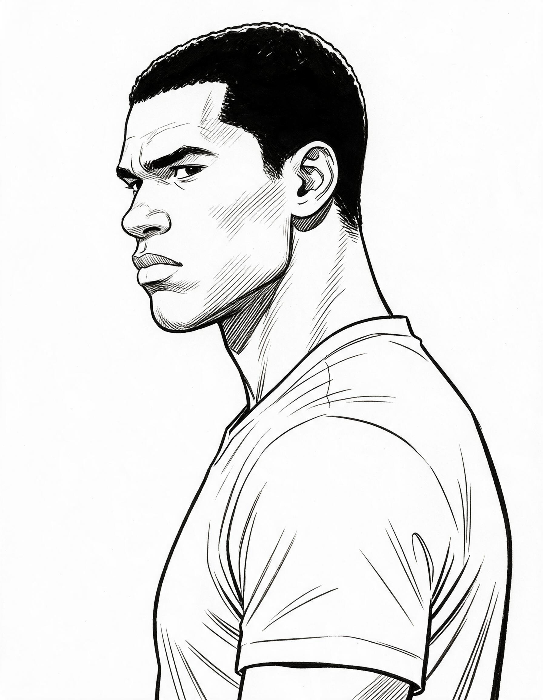
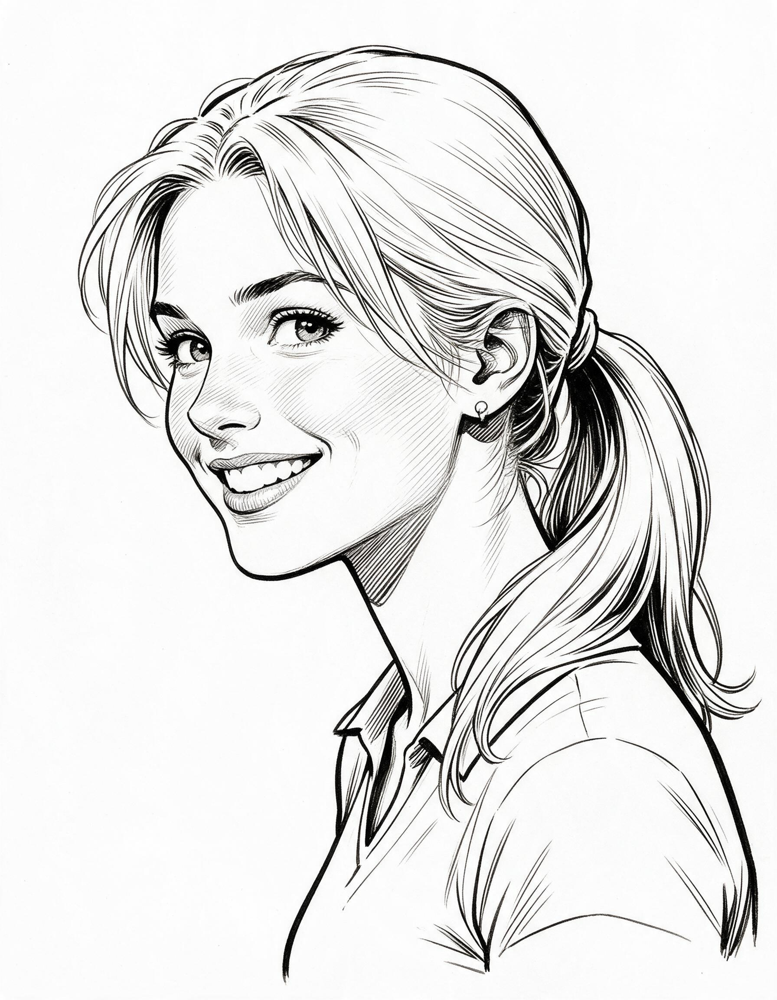

> **CLOSED 2026-11-20 — nothing is wanted here.** The founder closed the request for these four drawings and
> answered with a better mechanism: *"Kythe overall should have an image of each member, generated from a bit of
> text visible, with default text, and editable, in the member's UI."* That is `portrait.js` at the repository root —
> a deterministic drawing from a sentence in `state/identity.md`, per circle, per member, with nothing to store.
> This page stays as the record of what was asked and why it was the wrong thing to ask for: a drawing exists only
> for the circles somebody was willing to draw for, and it is one face for every circle.

# The faces — what goes in this folder, and why

Six people play on this court. Each of them is a body built from parameters (`../colette.glb` and so on), and a
drawing in this folder is the one thing about them that is not arithmetic. Two drawings exist — `dmitri.jpg` and
`gwen.jpg`. The other four have none, so the break card shows the person's initial instead of their face.

**What the break card is.** Between points the film cuts to a still of one player: 248 pixels wide, on the left of
the screen, under the point's caption. It greyscales whatever it is given, so colour in a drawing is thrown away.
This is why the drawings here are ink, not paint.

## The two that exist, as the pattern to copy

Between them they say everything the other four have to match:

- **Black-and-white ink line drawing on plain white.** No colour, no background, no scenery, no border.
- **Head and shoulders**, turned about three-quarters from the viewer, cropped at the chest. Not a full body, not
  a passport photo, not a face floating in white space.
- **1792 × 2304 pixels (3:4 portrait).** Any close portrait shape works — the card only scales it — but keep the
  head in the upper two thirds, because the bottom of the frame sits behind the name.
- **A person, not a symbol.** These two are readable as two different people at a glance: hair, age, build, and
  what they are thinking. That is the whole job.

## The four that are missing

| file | who | how to tell them apart |
|---|---|---|
| `colette.jpg` | Colette — female, 1.66m, slight build, early thirties | dark brown hair in a low bun; calm, a closed-mouth half-smile; the smallest of the six |
| `ada.jpg` | Ada — female, 1.74m, tall and athletic, mid twenties | mid-brown hair in a high ponytail; intent, unsmiling, looking straight past the viewer |
| `remy.jpg` | Remy — male, 1.81m, lean, mid twenties | very dark hair cropped close; clean-shaven; a considering look, as if the next shot is a decision |
| `bo.jpg` | Bo — male, 1.92m, heavy build, late twenties | black hair cropped shorter than Remy's; broad jaw; an open grin — the only one of the six who is enjoying himself |

Dmitri's drawing is a stern profile with a crew cut; Gwen's is a smile with a blonde ponytail and a small earring.
Nobody new should read like either of them.

**Colour is not needed and cannot be used.** The bodies on court are colour-coded (Colette's kit is plum, Ada's
slate blue, Remy's teal, Bo's cream) so that six figures can be told apart at broadcast distance. The drawing is
greyscaled, so that belongs to the court and not to this folder.

## How to add one

1. Draw it (or have it drawn, or generate it).
2. Name it exactly as the table says — lower case, `.jpg` — because the page builds the path from the body's name:
   `bodies/faces/<name>.jpg`.
3. **Add file → Upload files** on this page, drag the four in, **Commit changes**.

Nothing here is required for the film to run. A member with no drawing gets their initial in the same card, which
is why the four missing ones are a gap rather than a fault. When a drawing is added, the card finds it with no
other change: the page asks for the file and falls back to the initial only if the file is not there.
